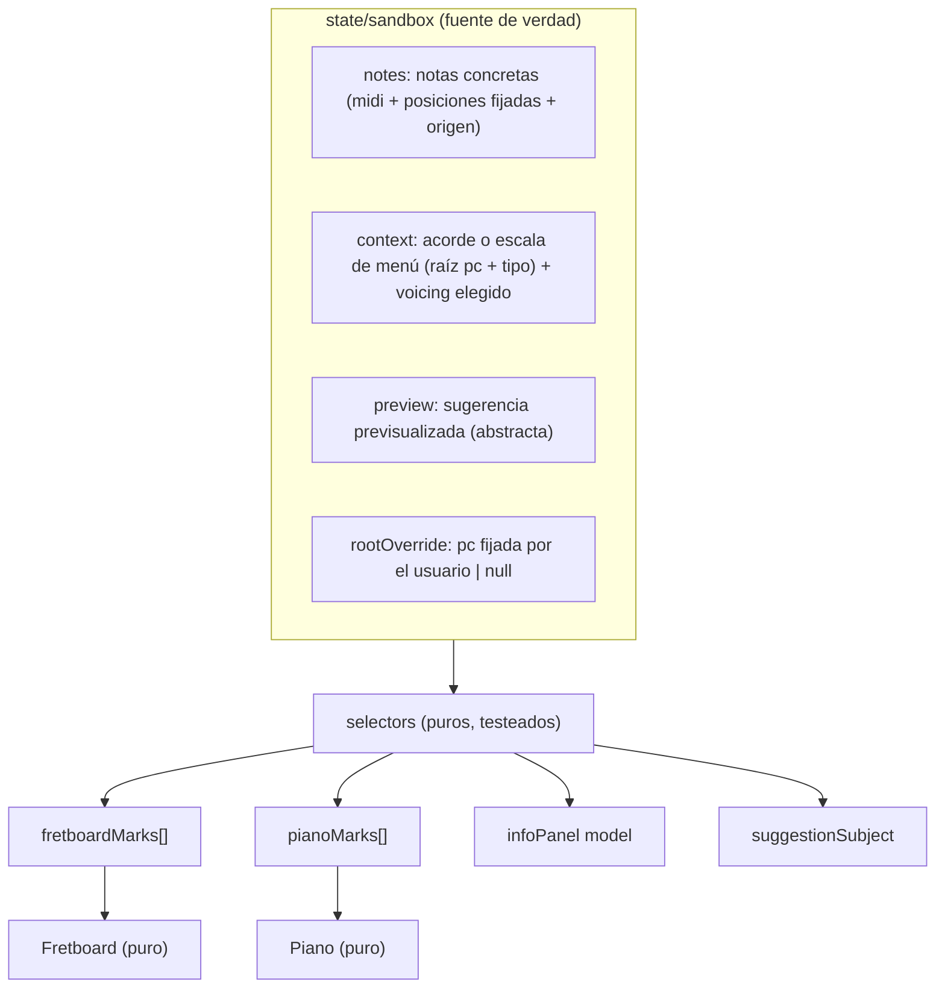

# Guitar Aid — Plan de la Fase 1 (Sandbox) · v2

Basado en [Requisitos.md](Requisitos.md) y [decisiones.md](decisiones.md). **Este archivo es la versión canónica del plan de la Fase 1.** Las ampliaciones y cambios de la Fase 1.1 se especifican en [plan_fase1_1.md](plan_fase1_1.md) y se registran en [decisiones.md](decisiones.md).

**Qué cambia respecto a la v1:**
- La selección se organiza en capas: notas concretas por un lado y contextos abstractos por clases de altura por otro.
- Los componentes de los instrumentos son puros: reciben por props qué deben resaltar.
- La API de teoría acepta notas con peso y una raíz opcional, y devuelve candidatos con puntuación y razones.
- Los voicings salen de un diccionario de formas conocidas, no de un algoritmo.
- Se fija el orden teoría → estado → interfaz, y cada hito trae sus pruebas.

---

## 1. Stack (sin cambios)

| Área | Elección |
|---|---|
| Lenguaje / build | TypeScript `strict` + Vite |
| UI | React 19, SVG a mano, CSS Modules |
| Teoría | Módulo propio. `tonal` solo como utilidad interna para deletreo de notas e intervalos. **El catálogo, la detección y el ranking son nuestros.** |
| Estado | Zustand (+ `persist` solo para ajustes) |
| Sonido | Web Audio API a mano |
| Tests / calidad | Vitest + Testing Library, ESLint (regla de capas) + Prettier |
| Paquetes | pnpm |

> [!NOTE]
> `tonal` deja de ser el motor de detección. Su `Chord.detect` trabaja con texto y con su propio diccionario. Con un catálogo propio por clases de altura, A♯ y B♭ dan exactamente el mismo resultado y controlamos el ranking.

---

## 2. Modelo de selección por capas

La v1 trataba todo como notas MIDI. Esto no funciona con escalas ni acordes de menú: una escala son clases de altura sin octava y debe iluminar todo el mástil. Si se convirtiera en unas 35 notas MIDI, el panel listaría 35 notas, el detector de acordes recibiría 35 alturas y "reproducir escala" tocaría 5 octavas seguidas.



| Capa | Contenido | Ejemplo |
|---|---|---|
| `notes` | Notas **con octava**, del clic en guitarra o piano. Cada una guarda sus posiciones fijadas y su origen. | E3 fijada en (5, 7) |
| `context` | Acorde o escala del menú como **clase de altura de la raíz + tipo**. No se convierte en notas MIDI. En los acordes guarda también el voicing elegido. | `{ kind: 'scale', root: 9, type: 'minorPentatonic' }` |
| `preview` | Lo mismo que `context`, pero temporal y dibujado en otro color. | Sugerencia "A dórico" bajo el ratón |
| `rootOverride` | Raíz fijada a mano por el usuario. | C |

**Cómo se usa cada capa:**
- **Panel de información:**
  - Para `notes`, lista las notas concretas de grave a aguda, con sus intervalos consecutivos y respecto a la raíz.
  - Para `context`, lista **sus clases de altura** (por ejemplo, 5 notas para la pentatónica) con su intervalo y grado respecto a la tónica. Esto cubre el criterio 3: Am7 → fundamental, 3ª menor, 5ª justa, 7ª menor.
- **Detección de acordes:** solo se aplica a `notes`. Un acorde de menú ya se sabe cuál es.
- **Reproducir:**
  - Notas concretas: se tocan tal cual.
  - Acorde de menú: se toca el voicing elegido.
  - Escala de menú: **una octava** ascendente desde la tónica en la octava 3 hasta la tónica superior (C3–C4; con la tónica más alta, B3–B4). Todo queda en la zona media del mástil y del piano.
- **Convivencia (6.1):**
  - Las capas se dibujan superpuestas.
  - El panel de sugerencias analiza **la última capa que se modificó**. Su cabecera indica siempre con claridad qué está analizando: el objeto y su origen, por ejemplo "Analizando: A pentatónica menor (menú)" o "Analizando: notas pulsadas C3 E3 G3". Si las dos capas tienen contenido, se puede cambiar entre ellas con pestañas.
  - "Limpiar" vacía todas las capas.

### Raíz

- **Sandbox:** la raíz es la que fija el usuario o, si no fija ninguna, la nota más grave de `notes`. En `context`, la raíz es su tónica.
- **Control principal:** un desplegable en el panel de información con "Automática" y las 12 notas. Sirve para fijar una raíz que no se ha pulsado y para volver al modo automático. "Automática" significa la nota más grave.
- **Atajo opcional:** clic derecho sobre una nota en cualquier instrumento → "fijar como raíz". Es solo un atajo; el desplegable sigue siendo el control visible y fácil de descubrir.
- **No hay estimación de raíz.** Esa función queda para el modo Canción.
- La raíz **ordena** los candidatos pero **no los filtra**. Con C-E-G-A y raíz C, se muestran C6 (primero, porque la raíz coincide) y Am7/C. Esto cumple el criterio 5.

### Componentes puros

`Fretboard` y `Piano` (en `ui/instruments/`) **no leen el estado del Sandbox**. Reciben marcas y devuelven eventos:

```ts
type MarkRole = 'pinned' | 'equivalent' | 'tone' | 'root' | 'preview';
interface FretMark { string: 1|2|3|4|5|6; fret: number; role: MarkRole; label?: string }
interface KeyMark  { midi: number; role: MarkRole; label?: string }

<Fretboard tuning={…} frets={24} leftHanded marks={FretMark[]} onPositionClick={…} />
<Piano range={{ from: 36, to: 96 }} marks={KeyMark[]} onKeyClick={…} />
```

La traducción del estado a marcas la hacen funciones puras de `state/sandbox/selectors`, con sus propios tests. Los contenedores de `ui/sandbox/` solo conectan las piezas. Así, Tests y Canción podrán reutilizar los instrumentos tal cual.

---

## 3. API del módulo de teoría

Todas las funciones de análisis siguen el mismo contrato:

```ts
type PitchClass = 0|1|2|3|4|5|6|7|8|9|10|11;
interface WeightedPc { pc: PitchClass; weight: number }      // peso por nota (1 = normal)
interface AnalysisInput { notes: WeightedPc[]; root?: PitchClass }

interface Reason { code: ReasonCode; params?: Record<string, string | number> }
interface Candidate<T> { value: T; score: number; reasons: Reason[] }

detectChords(input): Candidate<ChordRef>[]          // [] = "no reconocido"
rankScalesForChord(input): Candidate<ScaleRef>[]
chordsContaining(pc): Candidate<{ chord: ChordRef; role: Degree }>[]
scalesContaining(pc) / scalesOnTonic(pc): Candidate<ScaleRef>[]
diatonicChords(scale): { roman: string; chord: ChordRef }[]
relatedScales(scale): Candidate<ScaleRef>[]
progressionsFor(chord): Candidate<{ key: KeyRef; degree: string; template: ProgressionRef }>[]
```

- Las **razones son estructuradas** (por ejemplo, `{ code: 'containsChordTones', params: { n: 3, of: 3 } }`). La UI las convierte en texto ("contiene las 3 notas del acorde"), y los tests comprueban el código de razón, no el texto.
- Los pesos ya sirven en la Fase 1: una nota fijada puede pesar más que una del contexto. Pero sobre todo preparan Canción, donde el peso será la duración o la frecuencia de cada nota.

### Detección de acordes por clases de altura

Cada calidad del catálogo define intervalos **requeridos** y **opcionales**. Por ejemplo, el acorde `9` tiene la 5ª opcional.

- **Coincide** cuando todos los requeridos están presentes y no sobra ninguna nota fuera de requeridos y opcionales.
- Se prueban las 12 raíces posibles contra todas las calidades. Son 12 × 12 comprobaciones sobre máscaras de bits, así que el coste es despreciable.
- **Orden de los candidatos:** primero los que tienen la raíz igual a la raíz de entrada, luego menos opcionales omitidos, luego el peso de la calidad en el catálogo.
- El nombre se deletrea al final según el contexto de enarmonía.

### Ranking de escalas para un acorde

1. **Filtro:** la escala debe contener todas las notas del acorde (inclusión).
2. **Orden**, por este criterio:
   1. si la raíz de la escala coincide con la del acorde;
   2. el **peso** de la escala en el catálogo (`scales.ts` incluye un campo `weight`);
   3. el número de notas sobrantes (menos es mejor).
3. Si algún caso da un resultado poco musical, **se ajustan los pesos en los datos, no la arquitectura**. Hay tests de referencia, por ejemplo: Am7 → A dórico, A eólico y A pentatónica menor arriba.

---

## 4. Voicings: diccionario más adaptación

`theory/data/voicings/standard.ts` contiene formas conocidas para la afinación estándar:

| Familia | Contenido |
|---|---|
| Abiertas | Formas absolutas (C, A, G, E, D, Am, Em, Dm, A7, E7, D7, Cmaj7, Amaj7…) |
| Cejilla / CAGED | Formas móviles relativas a la raíz, con raíz en la 6ª y en la 5ª (forma de E, A, C, D, G) |
| Séptimas | Drop 2 (cuerdas 1-4 y 2-5) y drop 3 (raíz en la 6ª y en la 5ª) |
| Shell / 9 | Formas sin 5ª (raíz–3ª–7ª–9ª), que es la práctica habitual en guitarra |

Ejemplo de entrada:

```ts
{ id: 'barre-E-m7', quality: 'm7', family: 'barre-E', rootString: 6,
  frets: [0, 2, 0, 0, 0, 0] }           // relativos al traste de la raíz, cuerda 6 → 1; 'x' = muteada
```

> [!NOTE]
> El dato no almacena un campo `fingers`: el número de dedos requeridos se calcula directamente a partir de `frets` (1 dedo por cuerda pulsada `> 0`, contando como 1 solo dedo un tramo de cejilla en un mismo traste sin cuerdas intermedias en un traste inferior).

**Tests de integridad del diccionario (calculando notas reales con `positionToMidi`):** cada forma abierta en su raíz y cada forma móvil transpuesta a sus 12 raíces debe:
- contener todos los intervalos requeridos de su calidad;
- no tener notas ajenas al acorde;
- tener la fundamental en la nota más grave;
- abarcar como máximo 4 trastes;
- tener una digitación coherente (como máximo 4 dedos, calculados desde `frets` contando la cejilla como uno);
- cubrir las 12 calidades × 12 raíces con al menos un voicing por acorde.

**Verificación ergonómica (`pnpm voicings:print`):** script que imprime todas las formas de un acorde (p. ej. `pnpm voicings:print Am7` → `x02010 · A C E G · open` + tablatura ASCII) y genera [voicings.md](voicings.md) con la lista completa.

**Otras afinaciones:**

1. **Afinaciones desplazadas de forma uniforme** (Eb, D estándar): las mismas formas, con el traste desplazado. Es exacto.
2. **Adaptación por cuerda** (Drop D y similares): a cada cuerda se le aplica la diferencia respecto a la estándar. La forma se conserva si sigue cumpliendo las restricciones de arriba. Las formas que no usan la cuerda afectada quedan intactas.

Si una afinación no tiene ningún voicing válido (algo previsible en Open G, Open D y DADGAD), el navegador de voicings lo indica y la guitarra muestra las notas del acorde en todo el mástil. Las soluciones para afinaciones abiertas están en "Ideas posteriores" de [decisiones.md](decisiones.md).

---

## 5. Estructura de carpetas

```
src/
├── theory/                         # CAPA 1 — TS puro (ESLint prohíbe React/DOM)
│   ├── data/
│   │   ├── chords.ts               # calidades: requeridos, opcionales, peso, símbolos
│   │   ├── scales.ts               # tipos: intervalos, peso, familia/escala madre, alias
│   │   ├── tunings.ts
│   │   ├── progressions.ts
│   │   └── voicings/
│   │       └── standard.ts
│   ├── core/                       # pitch.ts, interval.ts, spelling.ts, pcset.ts (máscaras de bits)
│   ├── fretboard/                  # posiciones ↔ midi, equivalentes, recolocación
│   ├── analysis/                   # detectChords.ts, rankScales.ts, types.ts (Candidate, Reason)
│   ├── suggestions/                # forNote.ts, forChord.ts, forScale.ts
│   ├── voicings/                   # dictionary.ts, adapt.ts
│   └── index.ts                    # API pública
├── state/                          # CAPA 2 — depende solo de theory
│   ├── sandbox/                    # store.ts (notes/context/preview/root), selectors/ (marks, info, subject)
│   └── settings/                   # store persistido (6.7)
├── audio/                          # engine.ts, pluck.ts, playback.ts (acorde/arpegio/escala)
├── ui/                             # CAPA 3 — React
│   ├── instruments/                # Fretboard/, Piano/ — PUROS, solo props
│   ├── sandbox/                    # contenedores: conectan store → props
│   ├── toolbar/  pickers/  panels/  layout/  hooks/  styles/
│   └── App.tsx
└── main.tsx
```

Los tests van junto al código (`*.test.ts`). Los criterios de aceptación de teoría están en `src/theory/acceptance.test.ts`, un archivo explícito que cubre el criterio 9.

---

## 6. Orden de implementación y pruebas

Se sigue el orden de la sección 10 de los requisitos: **teoría → estado → interfaz**. **Cada hito incluye sus tests** y no se cierra si `pnpm test` y `pnpm lint` no pasan.

| # | Hito | Tests que incluye | Criterios |
|---|---|---|---|
| 0 | Esqueleto: Vite, TS, ESLint (capas), Prettier, Vitest, scripts | Test de humo + verificación de la regla de capas | — |
| **T1** | `core/` + `fretboard/` + `tunings.ts` | midi ↔ nombre, enarmonía por contexto, (cuerda, traste) ↔ midi, equivalentes, recolocación Drop D | **1, 2, 7** (teoría) |
| **T2** | `chords.ts` + `detectChords` + intervalos y grados | A♯ ≡ B♭, C-E-G → C, C-E-G-A → [C6, Am7] sin elegir, intervalos de Am7, conjunto sin acorde → `[]` | **3, 4, 5** |
| **T3** | `scales.ts` + `rankScales` + `suggestions/*` + `progressions.ts` | Notas de A pentatónica menor, diatónicos con romanos, escalas relacionadas, casos de referencia del ranking | **6** → **9 completo** |
| **T4a** | Diccionario de voicings estándar (formas abiertas y cejilla en las 12 calidades) + `pnpm voicings:print` ([voicings.md](voicings.md)) | Integridad con `positionToMidi`, dedos desde `frets`, cobertura 12 × 12 | — |
| **T4b** | Adaptación de voicings a otras afinaciones (Eb, D, Drop D y abiertas) | Integridad con `positionToMidi(tuning, …)` y adaptación por afinación | — |
| **S1** | `state/sandbox` + selectores de marcas, panel y sujeto de sugerencias | Capas, fijar/desfijar, marcas llenas/huecas, raíz, cambio de afinación | 1, 2, 7 (estado) |
| **S2** | `state/settings` + persistencia | Serializa solo los ajustes; la selección no se guarda | 8 (estado) |
| U1 | Mástil y piano estáticos (puros) con afinación, zurdo, C2–C7 | Render y eventos con Testing Library | — |
| U2 | Selección y sincronización | Integración contenedor ↔ store | 1, 2, 7 |
| U3 | Etiquetas nota / intervalo / grado + panel de información | Componente del panel | 3, 4, 5 |
| U4 | Selectores de acorde y escala + navegador de voicings | Pickers | 3, 6 |
| U5 | Panel de sugerencias + previsualización + aplicar | Interacción | 6 |
| U6 | Sonido | `playback` con un AudioContext simulado | — |
| U7 | Persistencia en la UI, layout, atajos, accesibilidad | Recarga simulada | 8 |

> [!IMPORTANT]
> El criterio 9 queda cumplido al cerrar **T3**, antes de empezar con la interfaz. Los hitos U1–U7 corresponden a los hitos (1)–(7) del documento y cada uno termina con instrucciones para ejecutarlo y probarlo.

---

## 7. Decisiones cerradas (antes abiertas)

1. **Sujeto de las sugerencias:** se analiza la última capa modificada, el panel indica siempre qué está analizando y se puede cambiar con pestañas.
2. **Fijar raíz:** un desplegable en el panel de información con "Automática" y las 12 notas. El clic derecho es solo un atajo opcional.
3. **Reproducir escala:** una octava desde la tónica en la octava 3 (C3–C4).
