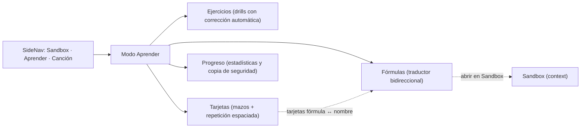
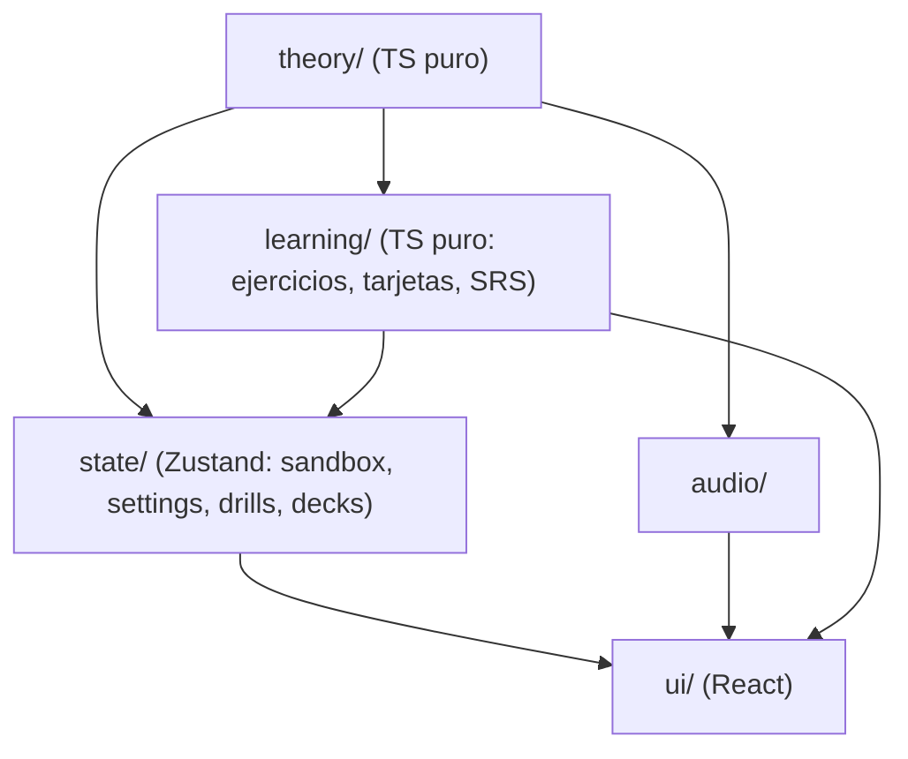
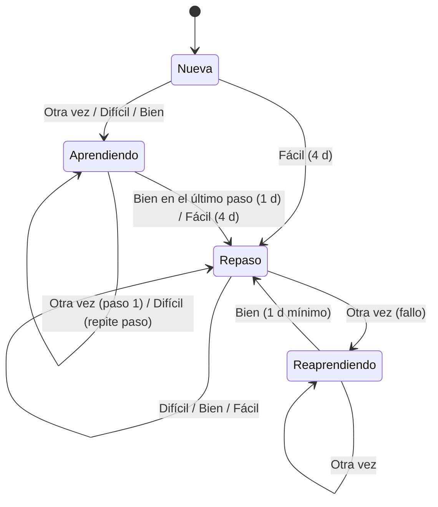

# Guitar Aid — Plan de la Fase 2 (Modo Aprender: ejercicios, tarjetas y fórmulas) · v1

Documento de **planificación y alcance** de la Fase 2. Fija qué se construye, con qué arquitectura, en qué hitos y con qué criterios de aceptación. El diseño visual detallado está especificado en [interfaz_fase2.md](interfaz_fase2.md) (basado en las maquetas [Ejercicios.png](Ejercicios.png), [Tarjetas.png](Tarjetas.png), [Fórmulas.png](Fórmulas.png) y [Progreso.png](Progreso.png)), que prevalece sobre este documento en lo relativo a la interfaz.

Base: [Requisitos.md](../Requisitos.md) (§9, hoja de ruta), [plan_fase1.md](../Fase-1/plan_fase1.md), [plan_fase1_1.md](../Fase-1/plan_fase1_1.md), [decisiones.md](../decisiones.md) e [interfaz.md](../interfaz.md).

---

## 1. Visión y objetivos

La Fase 1 y la 1.1 dejan un Sandbox para **explorar**. La Fase 2 añade un modo para **entrenar y memorizar**. Mantiene la idea de toda la aplicación: pensar en notas, intervalos y grados, no en formas.

| # | Objetivo | Cómo lo cubre la Fase 2 |
|---|---|---|
| O1 | **Dejar de ver el mástil como un conjunto de patrones** y verlo de forma lineal, por intervalos | Ejercicios en **una sola cuerda** (vista lineal, como el piano), intervalos entre pares de cuerdas (incluida la irregularidad Sol–Si), y ejercicio de **etiquetar formas conocidas** con sus intervalos. La corrección se muestra siempre también en el piano, que es lineal. |
| O2 | **Memorizar las notas** del mástil | Ejercicios de encontrar y nombrar notas, con mapa de aciertos por posición y práctica adaptativa centrada en las posiciones donde más se falla. |
| O3 | **Memorizar los intervalos** del mástil | Ejercicios de intervalos (encontrar, nombrar, mapear todas las posiciones de un intervalo alrededor de una raíz). |
| O4 | **Memorizar a largo plazo** acordes, escalas, progresiones y fórmulas | **Tarjetas con repetición espaciada** al estilo Anki: mazos propios formados por subconjuntos del catálogo, valoración *Otra vez / Difícil / Bien / Fácil* y planificación de la siguiente aparición. Tres mazos predefinidos: Principiante, Intermedio y Avanzado. |
| O5 | **Traducir entre fórmula y nombre** en los dos sentidos | Sección **Fórmulas**: acorde o escala → intervalos que lo forman; intervalos → acordes y escalas que encajan (exactos y cercanos). Las mismas traducciones existen también como tipos de tarjeta. |

**Principio heredado:** la Fase 2 debe ser útil por sí sola y no puede romper el Sandbox. Todo lo que añade va en el modo nuevo y en módulos nuevos. Los cambios en módulos existentes son pequeños y compatibles con lo que ya hay.

---

## 2. Estructura del modo «Aprender»

El modo que el menú lateral llama hoy *Tests* pasa a llamarse **Aprender** (pendiente de confirmar, §11). Tiene cuatro secciones:



| Sección | Para qué sirve | Respuesta | Corrección |
|---|---|---|---|
| **Ejercicios** | Práctica intensiva y corta (sesiones de N preguntas o de tiempo fijo) de notas e intervalos en el mástil | Clic en mástil o piano, o elegir entre opciones | **Automática**: la aplicación sabe la respuesta |
| **Tarjetas** | Memoria a largo plazo con repetición espaciada | Ver la pregunta → pensar → **mostrar respuesta** | **Autoevaluación**: el usuario elige *Otra vez / Difícil / Bien / Fácil* |
| **Fórmulas** | Consulta y exploración (no es un test) | Elegir acorde/escala o activar intervalos | — |
| **Progreso** | Ver puntos débiles y evolución; exportar e importar los datos | — | — |

> [!NOTE]
> **Por qué separar Ejercicios y Tarjetas:** son dos ritmos de estudio distintos. Los ejercicios generan preguntas al azar (infinitas, con corrección automática) y miden precisión y velocidad. Las tarjetas son un conjunto finito y elegido por el usuario, planificado en días. Comparten el motor de preguntas y los instrumentos, pero no la planificación.

---

## 3. Arquitectura

### 3.1. Nueva capa `src/learning/` (TypeScript puro)

Los generadores de preguntas, los correctores, el modelo de tarjetas y el planificador de repetición espaciada son lógica pura y testeable, igual que la teoría. Pero **no son teoría musical**, así que van en una capa nueva entre `theory` y `state`:



- **Regla ESLint nueva** (`eslint.config.js` + `src/architecture/layers.test.ts`): `learning` puede importar `theory`. No puede importar React, DOM, Zustand, `state`, `ui` ni `audio`.
- **Aleatoriedad con semilla:** todos los generadores reciben un `Rng` inyectable (p. ej. *mulberry32*). Con la misma semilla salen las mismas preguntas, así que los tests son deterministas.
- **Reloj inyectable:** el planificador recibe `now: number` (ms). `Date.now()` solo se usa en `state`.

### 3.2. Estructura de carpetas propuesta

```
src/
├── theory/
│   └── formulas/                  # NUEVO: formulaOf, identifyByFormula, intervalos compuestos
├── learning/                      # NUEVA CAPA — TS puro
│   ├── rng.ts                     # RNG con semilla + utilidades (pick, shuffle, weightedPick)
│   ├── answers.ts                 # modelo de respuesta (AnswerInput) y resultado (Grade)
│   ├── drills/                    # catálogo de ejercicios: generadores + correctores + config
│   │   ├── types.ts
│   │   ├── notes.ts               # A1, A2
│   │   ├── intervals.ts           # B1–B4
│   │   ├── shapes.ts              # B5
│   │   ├── build.ts               # C1, C2
│   │   └── adaptive.ts            # elegir con más peso los elementos débiles
│   ├── cards/
│   │   ├── ids.ts                 # IDs estables de tarjeta (sujeto + faceta) y su parser
│   │   ├── facets.ts              # resolver un ID → contenido de anverso/reverso
│   │   ├── builder.ts             # reglas de selección de un mazo → lista de IDs
│   │   └── presets.ts             # mazos Principiante / Intermedio / Avanzado (datos)
│   └── srs/
│       ├── scheduler.ts           # SM-2 (variante de Anki): schedule(state, rating, now)
│       └── queue.ts               # cola diaria: límites, aprendizaje → repaso → nuevas
├── state/
│   ├── shared/marks.ts            # MarkRole, FretMark y KeyMark (se mueven aquí y se reexportan)
│   ├── drills/                    # sesión de ejercicio en curso + estadísticas persistidas
│   └── decks/                     # mazos, estado SRS por mazo, historial, exportar/importar
└── ui/
    ├── shell/                     # AppShell: SideNav + elección de modo (sale de SandboxView)
    └── learn/                     # LearnView + secciones Ejercicios, Tarjetas, Fórmulas, Progreso
```

### 3.3. Cambios en módulos existentes (pequeños y compatibles)

| Módulo | Cambio | Motivo |
|---|---|---|
| `ui/sandbox/SandboxView.tsx` | Sacar `SideNav` y la elección de modo (`currentMode` es hoy un `useState` local) a un `AppShell` en `App.tsx` | El modo Aprender no puede vivir dentro de `SandboxView`. El estado del Sandbox ya está en un store único, así que no se pierde al cambiar de modo. |
| `state/sandbox/selectors/marks.ts` | Mover los tipos de marca a `state/shared/marks.ts` y reexportarlos | Los selectores de `state/drills` también generan marcas. |
| `MarkRole` + CSS de `Fretboard`/`Piano` | Roles nuevos: `question` (dato de la pregunta), `correct`, `wrong` y `missed` (posición correcta que no se marcó) | Mostrar la corrección sin depender solo del color (forma o borde, como en 1.1). |
| `Fretboard` (puro) | Props opcionales `activeStrings?`, `fretRange?` (las zonas fuera se atenúan y no responden al clic) y `showInlays?` | Ejercicios en una cuerda o una zona del mástil. Opción de ocultar los puntos de referencia para no contar trastes con ellos. |
| `theory/core/interval.ts` | Añadir `P8` y los intervalos compuestos que use el catálogo (`9`) en las tablas de nombres | Ejercicios hasta la octava y fórmulas con extensiones. |
| `audio/playback.ts` | `intervalEvents(a, b, mode: 'melodic' \| 'harmonic')` | Oír el intervalo al corregir. |
| `state/settings` | `lastMode` (opcional) y atajos globales según el modo | Que `C` (Limpiar) no actúe sobre el Sandbox mientras se estudia. |

---

## 4. Teoría nueva: fórmulas (`src/theory/formulas/`)

### 4.1. Nombre → fórmula

```ts
interface FormulaTone { semitones: number; degree: Degree; intervalLong: IntervalLongName; pc: PitchClass }
formulaOfChord(chord: ChordRef): FormulaTone[]   // Am7 → 1 ♭3 5 ♭7 (A C E G)
formulaOfScale(scale: ScaleRef): FormulaTone[]   // D dórico → 1 2 ♭3 4 5 6 ♭7
```

Se apoya en lo que ya existe: `chordTones` (ya resuelve `♭5`/`♯5`/`9`/`♭♭7` según la calidad) y los intervalos de `scales.ts`.

### 4.2. Fórmula → nombre

```ts
interface FormulaQuery { semitones: number[]; root?: PitchClass; kind?: 'chord' | 'scale' | 'any' }
identifyByFormula(q): {
  exact: Candidate<ChordRef | ScaleRef>[];   // misma colección de intervalos sobre la raíz
  near: Candidate<ChordRef | ScaleRef>[];    // se añade o se quita 1 nota (razón: añade X / quita Y)
  rotations: Candidate<ChordRef | ScaleRef>[]; // mismas notas con otra raíz (1 ♭3 5 ♭7 ≡ 6 sobre el ♭3; dórico ≡ mayor sobre el ♭7)
}
```

- La raíz es el `1` (siempre presente). Sin `root` se devuelven calidades y tipos. Con `root` se devuelven acordes y escalas concretos con nombre.
- Los acordes se buscan reutilizando las máscaras de `detectChords` (5ª opcional en `9`). Las escalas, por igualdad de máscara. Las cercanas, por distancia de 1 nota.
- Las razones son estructuradas, como en todo el proyecto (`formulaExact`, `formulaAddsTone`, `formulaMissingTone`, `sameNotesOtherRoot`).

### 4.3. Nombres de intervalo

Los intervalos se nombran **por semitonos**: los 12 nombres actuales más `P8` y los compuestos del catálogo. El tritono se escribe `♭5` o `♯4` según la fórmula de la que venga (`♭5` en `m7♭5`, `♯4` en lidio), igual que ya hace `chordTones`. **Fuera de alcance:** la ortografía diatónica completa (distinguir 4ª aumentada de 5ª disminuida como intervalos distintos en los ejercicios).

---

## 5. Ejercicios (drills)

### 5.1. Modelo común

```ts
interface DrillQuestion<P = unknown> {
  id: string;                 // estable dentro de la sesión
  drill: DrillId;
  itemKey: string;            // clave estadística (p. ej. "interval:m3|pair:3-2"), base del modo adaptativo
  prompt: P;                  // datos para pintar la pregunta (texto + marcas 'question')
  answerKind: 'positions' | 'pitchClass' | 'interval' | 'labels' | 'choice';
  expected: ExpectedAnswer;   // conjunto de posiciones, pc, intervalo, etiquetas…
  mode: 'all' | 'first';      // «todas las posiciones» o «la primera que se te ocurra»
}
grade(question, input: AnswerInput): Grade  // { correct, partial?, hits, misses, extras, score }
```

- **`AnswerInput` no depende de la interfaz:** posiciones `(cuerda, traste)`, notas MIDI, clases de altura, una opción o un intervalo. Hoy llega por **clic en el mástil, el piano o los botones**. En el futuro podrá llegar del **audio** (Fase 4) sin cambiar el corrector (§10).
- **Corrección visible:** las posiciones que se marcan bien se pintan como `correct`, las que sobran como `wrong` y las que faltan como `missed`. Siempre se muestra también **en el piano** con etiquetas de intervalo, y puede sonar la nota o el intervalo.
- **Configuración de sesión:** cuerdas activas, rango de trastes (0–5, 0–12, 0–24 o personalizado), intervalos incluidos, dirección (ascendente, descendente o ambas), modo `all`/`first`, número de preguntas o tiempo límite, mostrar u ocultar los puntos de referencia y sonido al corregir. Se respetan la **afinación actual** y los ajustes de nombres (♯/♭) y zurdo.
- **Modo adaptativo** (`adaptive.ts`): la elección del siguiente elemento pesa más los `itemKey` con más fallos recientes o respuestas más lentas. La fórmula es simple, está documentada y tiene tests. Se puede desactivar (modo «aleatorio uniforme»).

### 5.2. Catálogo de ejercicios de la Fase 2

| ID | Nombre | Pregunta → respuesta | Objetivo | Variantes |
|---|---|---|---|---|
| **A1** | Encuentra la nota | Nombre de nota (o tecla marcada en el piano) → clic en sus posiciones | O2 | Una cuerda (lineal) o varias; `all` o `first`; rango de trastes |
| **A2** | Nombra la nota | Posición marcada en el mástil → elegir una de las 12 notas | O2 | Solo notas naturales o las 12; rango |
| **B1** | Intervalo en una cuerda | Posición de referencia + intervalo → clic en la nota destino **en la misma cuerda** | O1, O3 | Ascendente o descendente; subconjunto de intervalos |
| **B2** | Intervalo entre cuerdas | Referencia + intervalo + cuerda destino → clic en el destino | O1, O3 | Par de cuerdas fijo o al azar; resalta la irregularidad Sol–Si |
| **B3** | Nombra el intervalo | Dos posiciones marcadas (la raíz distinguida) → elegir el intervalo | O3 | Misma cuerda, cuerdas contiguas o cualquiera; sonido opcional |
| **B4** | Mapa de intervalos | Raíz + intervalo → marcar **todas** las posiciones de ese intervalo dentro de una ventana (p. ej. ±4 trastes) o en todo el mástil | O1, O3 | Ventana o mástil completo; intervalo por grado (`♭3`, `5`, `♭7`…) |
| **B5** | Etiqueta la forma | Forma conocida (voicing del diccionario o fragmento de escala) con marcas sin etiqueta y la raíz distinguida → asignar el grado a cada marca | O1 | Familias de voicing (abiertos, cejilla, 1–4, 1–3); tríadas o cuatríadas |
| **C1** | Construye el acorde | Raíz (posición) + calidad → marcar sus notas dentro de una zona o **en una sola cuerda** (arpegio lineal) | O1, O3 | Zona o cuerda única; calidades elegidas |
| **C2** | Escala en una cuerda | Tónica + tipo de escala + cuerda → marcar sus notas en orden a lo largo de la cuerda | O1 | Ascendente o descendente; tipos elegidos |

> [!TIP]
> B1, C1 (en cuerda única) y C2 son los ejercicios «lineales»: obligan a pensar en distancias de semitonos sobre una cuerda, como en el piano. B2 y B4 enseñan después cómo se trasladan esas distancias entre cuerdas. B5 hace el camino inverso: parte de una forma ya conocida y la descompone en intervalos.

### 5.3. Estadísticas de ejercicios

Se guardan agregados por `drill × itemKey`: intentos, aciertos, tiempo medio y los últimos 20 resultados. También un resumen de las últimas 100 sesiones (fecha, ejercicio, configuración, precisión y tiempo medio). Con eso se dibujan el **mapa de aciertos del mástil** (A1/A2), la **tabla de intervalos débiles** (B*) y la evolución por sesión.

---

## 6. Tarjetas con repetición espaciada

### 6.1. Modelo de tarjeta: sujeto + faceta, con ID estable

Una tarjeta **no guarda texto**: guarda un **ID estable** y su contenido se calcula a partir del catálogo cuando se muestra. Así, una corrección del catálogo llega sola a todas las tarjetas, y el progreso sobrevive a los cambios de la aplicación.

`cardId = "<sujeto>|<faceta>"`

| Sujeto | Formato | Facetas (anverso → reverso) | Ejemplo |
|---|---|---|---|
| Intervalo | `interval:<semitonos>` | `name>semitones`, `semitones>name` | `interval:3\|name>semitones` → «3ª menor» → «3 semitonos» |
| Nota en el mástil | `fretnote:s<c>f<t>` | `pos>name` | posición (5, 7) → «E» |
| Nota en una cuerda | `notestring:<pc>:s<c>` | `name>pos` | «G en la 6ª» → posiciones 3 y 15 |
| Calidad de acorde | `quality:<id>` | `name>formula`, `formula>name` | `quality:m7b5\|name>formula` → «m7♭5» → «1 ♭3 ♭5 ♭7» |
| Acorde concreto | `chord:<pc>:<id>` | `name>notes` | «Am7» → «A C E G» |
| Digitación | `voicing:<plantilla>@<pc>` | `name>shape`, `shape>name` | «C, forma abierta» → `x-3-2-0-1-0` en el mástil |
| Tipo de escala | `scaletype:<id>` | `name>formula`, `formula>name`, `mode>parent` | «Dórico» → «II grado de la escala mayor» |
| Escala concreta | `scale:<pc>:<id>` | `name>notes`, `name>parent` | «D dórico» → «D E F G A B C» / «modo de C mayor» |
| Grado en tonalidad | `degree:<pc>:<modo>:<grado>:<triads\|sevenths>` | `roman>chord` | «vi de G mayor» → «Em» |
| Progresión en tonalidad | `progression:<id>:<pc>` | `roman>chords`, `chords>roman` | «ii–V–I en C» → «Dm – G – C» |

- Las facetas visuales (`pos>name`, `name>pos`, `name>shape`, `shape>name`, `name>notes`) usan el **mástil y el piano puros** con marcas, y pueden **sonar**.
- Si un ID no se puede resolver con la afinación actual (p. ej. digitaciones en Open G, que no tiene diccionario), la tarjeta se **omite y se avisa**. No se borra ni pierde su progreso.

### 6.2. Mazos

- **Mazo** = `{ id, name, sources: DeckSource[], cardIds: string[], limits: { newPerDay, reviewsPerDay }, createdAt }`.
- **`sources`** son las reglas declarativas con las que se creó el mazo, para poder volver a editarlo. Ejemplos de reglas del constructor:
  - *Acordes:* calidades × raíces × facetas.
  - *Digitaciones:* calidades × familias (`open`, `barre-E`, `barre-A`, `strings-1-4`, `strings-1-3`) × raíces × facetas.
  - *Escalas:* tipos × tónicas × facetas, con el atajo **«modos de una escala madre en una tonalidad»** (p. ej. los 7 modos de C mayor).
  - *Progresiones:* plantillas × tonalidades. *Armonía diatónica:* tonalidades × tríadas/cuatríadas.
  - *Intervalos* y *notas del mástil:* cuerdas × rango de trastes × naturales o todas.
- **`cardIds`** es la lista materializada que sale de aplicar las reglas. Al editar las reglas se regenera la lista: las tarjetas que siguen **conservan su progreso**, las nuevas entran como nuevas y las retiradas se archivan (no se borra su historial).
- El ejemplo del usuario, *«tríadas en abierto y cejilla + modos principales de Do mayor»*, se crea con dos reglas: *Digitaciones* {`maj`, `m`} × {`open`, `barre-E`, `barre-A`} × raíces disponibles × {`name>shape`, `shape>name`} y *Escalas* «modos de C mayor» × {`name>notes`, `name>formula`, `name>parent`}.
- **El progreso es por mazo:** si la misma tarjeta está en dos mazos, cada mazo la planifica por separado (tal como se pidió).

### 6.3. Planificador: SM-2, variante de Anki

Funciones puras en `learning/srs/scheduler.ts`. Están detrás de una interfaz `Scheduler` para poder cambiarlas por FSRS en el futuro sin tocar el resto.



| Parámetro (en datos, ajustable) | Valor por defecto |
|---|---|
| Pasos de aprendizaje | 1 min, 10 min |
| Paso de reaprendizaje | 10 min |
| Intervalo de graduación / al pulsar Fácil | 1 d / 4 d |
| Facilidad inicial / mínima | 2,50 / 1,30 |
| Repaso · Otra vez | facilidad −0,20; fallo +1; intervalo nuevo = máx(1 d, intervalo × 0) tras reaprender |
| Repaso · Difícil | intervalo × 1,2 (mínimo +1 d); facilidad −0,15 |
| Repaso · Bien | máx(intervalo + 1, redondeo(intervalo × facilidad)) |
| Repaso · Fácil | redondeo(intervalo × facilidad × 1,3); facilidad +0,15 |
| Difícil en aprendizaje | repite el paso actual (en el primero, la media del 1º y el 2º: 5,5 min) |
| Límites diarios por mazo | 20 nuevas, 200 repasos |
| Cambio de día | 04:00 hora local |
| Intervalo máximo | 36 500 d |

- **Simplificaciones asumidas en la Fase 2:** sin aleatorización de intervalos (*fuzz*), sin bonificación por repasar tarde y sin reparto de carga entre días. Se pueden añadir sin cambiar el modelo de datos.
- **Cola de estudio** (`queue.ts`): primero las tarjetas en aprendizaje que ya tocan, luego los repasos pendientes y luego las nuevas (hasta el límite diario), intercaladas.
- **Vista previa de intervalos:** `previewIntervals(state, now)` devuelve lo que daría cada botón (p. ej. *Otra vez 1 min · Difícil 5,5 min · Bien 10 min · Fácil 4 d*). Así el usuario ve las consecuencias antes de elegir, como en Anki.
- **Historial de repasos:** `{ cardId, deckId, rating, at, prevInterval, newInterval, ease }`, limitado a las últimas 5000 entradas más agregados diarios.

### 6.4. Mazos predefinidos

Son **plantillas en datos** (`learning/cards/presets.ts`) escritas con las mismas reglas del constructor. Al añadir uno, se crea **una copia editable** del usuario con su propio progreso. Un test comprueba que todos los IDs de los tres mazos se resuelven en afinación estándar. Los recuentos exactos se anotarán en [decisiones.md](decisiones.md) al implementarlos.

| Mazo | Contenido |
|---|---|
| **Principiante** | Notas naturales en las cuerdas 6 y 5 (trastes 0–12) · intervalos de `m2` a `P8` (nombre ↔ semitonos) · fórmulas de `maj`, `m`, `5`, `7` · digitaciones `open` de `maj`, `m` y `7` · fórmulas de mayor, menor natural y pentatónicas · notas de C, G y D mayor y de A y E menor (pentatónica incluida) · `I–IV–V` e `I–V–vi–IV` en C, G, D, A y E |
| **Intermedio** | Todas las notas (con alteraciones) en las 6 cuerdas, trastes 0–12 · fórmulas de `m7`, `maj7`, `6`, `m6`, `sus2`, `sus4`, `dim`, `aug`, `add9`, `m7b5`, `dim7` y `9` · digitaciones `barre-E` y `barre-A` de `maj`, `m`, `7`, `m7` y `maj7` en raíces naturales · los 7 modos de la mayor (fórmula y grado en la madre) y las notas de los modos de C mayor · menor armónica y melódica · armonía diatónica en tríadas de C, G, D, F y A mayor y de A, E y D menor · `ii–V–I`, `vi–IV–I–V`, andaluza e `i–iv–v` en tonalidades comunes |
| **Avanzado** | Notas en todo el mástil (0–24), en los dos sentidos · todo el catálogo de fórmulas (19 calidades) en los dos sentidos · digitaciones `strings-1-4` (Drop 2 e inversiones) y `strings-1-3` (inversiones de tríadas) de `maj`, `m`, `maj7`, `m7` y `7` en raíces naturales · bebop, disminuidas y napolitanas (fórmula ↔ nombre) · armonía diatónica en cuatríadas en las 12 tonalidades mayores y en menor armónica y melódica · las 10 progresiones en las 12 tonalidades |

---

## 7. Sección Fórmulas (interfaz, alcance)

Se recomienda que sea **una sección propia** dentro de Aprender (es una herramienta de consulta, no un test) y que, además, sus dos sentidos existan como **facetas de tarjeta** (`name>formula` y `formula>name`), §6.1. Así se usa para explorar y también se memoriza.

- **Nombre → fórmula:** elegir acorde (tónica + calidad) o escala (tónica + tipo) → tabla grado · intervalo · semitonos · nota, marcas en el piano y en el mástil, sonido, y botón **«Abrir en Sandbox»** (pone ese `context`).
- **Fórmula → nombre:** activar o desactivar los grados (`1` fijo, `♭2` … `7`, más las extensiones del catálogo) con raíz opcional → coincidencias exactas (acordes y escalas), cercanas («añade ♭7», «quita 5») y mismas notas con otra raíz.

---

## 8. Persistencia

- **Stores nuevos persistidos con claves separadas** (`guitar-aid-decks` y `guitar-aid-drills`), cada uno con **`version: 1` y `migrate`** desde el principio, a diferencia de `settings`, que está en `version: 0` ([decisiones.md](decisiones.md), S2).
- Se sigue usando `localStorage` con `partialize`/`merge` defensivos (datos corruptos → valores por defecto seguros, sin romper la aplicación). Tamaño estimado: unos 2000 estados de tarjeta × ~120 B + historial limitado, muy por debajo del límite habitual de 5 MB. Si en el futuro hiciera falta más espacio, se cambia el `storage` de Zustand por IndexedDB sin tocar el modelo.
- **Exportar e importar en JSON** (mazos, progreso, historial y estadísticas). Como no hay backend ni cuentas, borrar los datos del navegador borraría todo el progreso: la copia de seguridad es **necesaria**, no un extra.
- La selección del Sandbox sigue sin guardarse entre sesiones. Una sesión de ejercicio a medias tampoco se guarda.

---

## 9. Alcance

### Dentro de la Fase 2

- `AppShell` con navegación real entre Sandbox y Aprender.
- Capa `learning/` con regla de capas.
- Teoría de fórmulas en los dos sentidos.
- Los 9 ejercicios de §5.2, con configuración, modo adaptativo, corrección en mástil y piano, sonido y estadísticas.
- Tarjetas con los 10 sujetos y sus facetas de §6.1, constructor de mazos, planificador SM-2, cola diaria, vista previa de intervalos e historial.
- Los 3 mazos predefinidos.
- Sección Fórmulas.
- Sección Progreso: mapa de aciertos del mástil, intervalos débiles, recuentos de tarjetas (nuevas, en aprendizaje, pendientes hoy) y retención.
- Exportar e importar.
- Atajos de teclado: `Espacio` muestra la respuesta, `1`–`4` valoran, `Enter` pasa a la siguiente pregunta.

### Fuera de la Fase 2 (preparado o para el futuro)

| Fuera de alcance | Estado |
|---|---|
| **Responder con la guitarra real (audio)** y detección automática | Fase 4. El modelo `AnswerInput` → `grade()` ya está preparado: el detector solo tendrá que producir MIDI o clases de altura. La latencia alta no es un problema en este uso. |
| **Tarjetas con respuesta verificada** (responder clicando en mástil, piano o grados y que la aplicación proponga la valoración) | Futuro (Fase 2.1). Las facetas visuales ya tienen `expected` calculable. Basta con reutilizar `grade()` y proponer *Otra vez* si falla y *Bien* si acierta. |
| Entrenamiento auditivo (reconocer intervalos o acordes de oído) | Futuro. |
| Partitura como forma de pregunta | Sigue fuera ([Requisitos.md](Requisitos.md) §2). |
| FSRS, *fuzz*, reparto de carga, enterrar tarjetas hermanas | Futuro. El planificador está detrás de una interfaz. |
| Importar mazos de Anki (`.apkg`), sincronizar, cuentas | Fuera (no hay backend). |
| Ortografía diatónica completa de intervalos (4ª aum. ≠ 5ª dism.) | Fuera (§4.3). |
| Digitaciones para afinaciones abiertas en tarjetas | Depende de la idea pendiente de [decisiones.md](decisiones.md). Hasta entonces, esas tarjetas se omiten con aviso. |
| Gamificación más allá de una racha diaria | Fuera. |

---

## 10. Hitos

Orden: **teoría y aprendizaje puro → estado → interfaz**. Cada hito incluye sus tests y no se cierra si `pnpm test`, `pnpm lint` y `pnpm build` no pasan. **A6–A9 están especificados en detalle en [interfaz_fase2.md](interfaz_fase2.md).**

| Hito | Contenido | Tests / verificación | Criterios |
|---|---|---|---|
| **A0 · Preparación** | `AppShell` en `App.tsx` (sacar `SideNav` y el modo de `SandboxView`), `LearnView` vacío con sus 4 pestañas, capa `learning/` con regla ESLint y casos nuevos en `layers.test.ts`, `rng.ts` con semilla, mover los tipos de marca a `state/shared/marks.ts`, atajos globales según el modo | `layers.test.ts`, `SandboxView.test.tsx` sin regresiones, test del shell (cambiar de modo conserva el estado del Sandbox) | a, p |
| **A1 · Fórmulas (teoría)** | `theory/formulas/`: `formulaOfChord`, `formulaOfScale`, `identifyByFormula` (exactas, cercanas, otra raíz), `P8` y compuestos en `interval.ts`, utilidades del mástil (`intervalBetween(posA, posB)`, `positionsAtInterval(tuning, pos, semis, { strings, fretRange })`) | Tests unitarios de teoría | b, c |
| **A2 · Motor de ejercicios (puro)** | `learning/answers.ts`, `drills/*`: generadores con semilla y correctores de los 9 ejercicios, modos `all`/`first`, `adaptive.ts` | Tests por ejercicio con semilla fija, casos límite (rango, afinación Drop D, tritono, irregularidad Sol–Si) | d, e, f, g, o |
| **A3 · Tarjetas y SRS (puro)** | `cards/ids.ts` (formato y parser), `facets.ts` (resolver los 10 sujetos), `builder.ts` (reglas → IDs), `presets.ts` (3 mazos), `srs/scheduler.ts` (SM-2 + `previewIntervals`), `srs/queue.ts` (límites, cambio de día) | Tests del planificador con reloj fijo, tests del constructor y de los mazos predefinidos (todos los IDs se resuelven) | h, i, k, l |
| **A4 · Estado de ejercicios** | `state/drills`: sesión (configurar → preguntar → responder → corregir → resumen), selectores de marcas con los roles `question`/`correct`/`wrong`/`missed`, estadísticas persistidas (`version: 1`) | `drills.test.ts` | d, g, m, n |
| **A5 · Estado de mazos y progreso** | `state/decks`: CRUD de mazos, regenerar al editar conservando el progreso, estado SRS por mazo, historial, exportar/importar JSON, `migrate`, datos corruptos → valores por defecto | `decks.test.ts` (ida y vuelta de exportar/importar, recarga simulada) | j, k, m |
| **A6 · UI: shell Aprender + Fórmulas** | Navegación del modo, sección Fórmulas en los dos sentidos con mástil, piano, sonido y «Abrir en Sandbox», roles de marca nuevos y props `activeStrings`/`fretRange`/`showInlays` en los instrumentos | Tests de componentes e integración | b, c, a |
| **A7 · UI: Ejercicios** | Selector de ejercicio y configuración, pantalla de pregunta (mástil, piano u opciones), corrección visible y sonora, resumen de sesión, atajos | Integración con store aislado | d, e, f, g, n, o |
| **A8 · UI: Tarjetas** | Lista de mazos (pendientes hoy), estudio (anverso → mostrar → 4 botones con vista previa de intervalos, atajos `Espacio`/`1`–`4`), constructor y editor de mazos, añadir predefinidos | Integración | h, i, j, k, l |
| **A9 · UI: Progreso, copia de seguridad y cierre** | Mapa de aciertos del mástil, intervalos débiles, estadísticas de mazos, exportar/importar en la UI, README y [decisiones.md](decisiones.md) | Integración + recarga simulada | m, q |

---

## 11. Criterios de aceptación de la Fase 2

La Fase 2 está terminada cuando existen y pasan tests para:

- **(a)** El menú lateral cambia entre Sandbox y Aprender. Al volver al Sandbox, la selección, el contexto y el `chordFocus` siguen igual. Mientras se está en Aprender, `C` no limpia el Sandbox.
- **(b)** `formulaOfChord(Am7)` = `1 ♭3 5 ♭7` (A C E G); `formulaOfScale(D dórico)` = `1 2 ♭3 4 5 6 ♭7`; `formulaOfChord(Bm7♭5)` = `1 ♭3 ♭5 ♭7`.
- **(c)** `identifyByFormula({ semitones: [0, 3, 7, 10] })` da `m7` como coincidencia exacta y `6` como «mismas notas con otra raíz». `[0, 2, 3, 5, 7, 9, 10]` da dórico como exacta y mayor como «mismas notas con otra raíz». `[0, 4, 7, 10, 14]` da `9` como exacta y `7` entre las cercanas («quita 9»). `[0, 4, 7, 11]` da `maj7` como exacta y `maj` entre las cercanas («quita 7»).
- **(d)** **B1** en estándar: referencia (5, 3) = C3 + `M3` ascendente en la misma cuerda → la única respuesta correcta es (5, 7) = E3. Marcar (4, 2) (también E3, pero en otra cuerda) se corrige como incorrecto.
- **(e)** **B3** distingue la irregularidad Sol–Si: (4, 2) → (3, 2) es `P4`, pero (3, 2) → (2, 2) es `M3`. **B2**: desde (3, 5) = C4, `M3` hacia la cuerda 2 → (2, 5) = E4.
- **(f)** **A1** en modo `all`, «C» en las 6 cuerdas, trastes 0–12, en estándar → el conjunto esperado es exactamente {(6, 8), (5, 3), (4, 10), (3, 5), (2, 1), (1, 8)}. Una respuesta parcial informa de aciertos, fallos y sobrantes. En modo `first` basta con una posición correcta.
- **(g)** **B5** con el voicing `x-0-2-2-1-0` (Am abierto) → las etiquetas correctas, de la cuerda 5 a la 1, son `1, 5, 1, ♭3, 5`.
- **(h)** Planificador sin *fuzz* y con reloj fijo: nueva + *Bien* → 10 min; + *Bien* → repaso a 1 d; repaso 1 d (facilidad 2,5) + *Bien* → 3 d; repaso 3 d + *Difícil* → 4 d y facilidad 2,35; repaso 10 d + *Fácil* → 33 d y facilidad 2,65; repaso 10 d + *Otra vez* → reaprendizaje a 10 min, facilidad 2,30 y, tras *Bien*, 1 d; nueva + *Fácil* → 4 d. La facilidad nunca baja de 1,30.
- **(i)** El mazo de ejemplo «tríadas `maj`/`m` en `open` y cejilla + modos de C mayor» contiene, entre otras, `voicing:open-C-maj@0|name>shape` y `scale:2:dorian|name>notes`, y ninguna tarjeta que no salga de sus reglas.
- **(j)** Una misma tarjeta en dos mazos se planifica por separado: valorarla en un mazo no cambia su fecha en el otro. Al editar las reglas de un mazo, las tarjetas que siguen conservan su estado SRS.
- **(k)** Con el límite de 20 nuevas al día, en un mismo día no se presentan más de 20 tarjetas nuevas de ese mazo. El contador se reinicia a las 04:00 hora local.
- **(l)** Existen los mazos Principiante, Intermedio y Avanzado. Todos sus IDs se resuelven en afinación estándar, y añadir uno crea una copia editable con progreso propio.
- **(m)** Tras recargar se conservan los mazos, el estado SRS, el historial y las estadísticas de ejercicios. Exportar y volver a importar da un estado idéntico. Datos corruptos en el almacenamiento → valores por defecto sin errores.
- **(n)** Al corregir un ejercicio, el mástil y el piano muestran las posiciones `correct`/`wrong`/`missed` diferenciadas por forma o borde (no solo por color), con etiquetas de intervalo respecto a la referencia.
- **(o)** Los ejercicios respetan la afinación actual: en Drop D, «D» en la cuerda 6, trastes 0–12, da {(6, 0), (6, 12)}.
- **(p)** `learning/` no importa React, DOM, Zustand, `state`, `ui` ni `audio` (regla de capas con tests).
- **(q)** El modo adaptativo, con la misma semilla, elige con más frecuencia un `itemKey` con fallos recientes que uno sin fallos (test estadístico determinista).

---

## 12. Decisiones cerradas

| # | Decisión | Propuesta | Estado |
|---|---|---|---|
| 1 | Nombre del modo | **Aprender** (Ejercicios · Tarjetas · Fórmulas · Progreso) | *Confirmado:* se llamará Aprender (sustituye a "Tests") |
| 2 | Dónde va el traductor de fórmulas | **Sección propia + facetas de tarjeta** | *Confirmado:* ambas coexistirán (sección de consulta/exploración + facetas evaluables) |
| 3 | Algoritmo de repetición espaciada | **SM-2 (Anki clásico)** detrás de una interfaz | *Confirmado:* SM-2 inicialmente, con arquitectura desacoplada para FSRS futuro |
| 4 | Respuesta verificada en tarjetas (clic en la solución) | **Fuera de la Fase 2**, preparada | *Confirmado:* pospuesto para Fase 2.1 (muy sinérgico con FSRS) |
| 5 | Nombres de intervalo | **Por semitonos**, con `♭5`/`♯4` según la fórmula | *Confirmado:* sin distinción diatónica teórica adicional (4ª aum. ≠ 5ª dism.) |
| 6 | Mazos predefinidos | **Copia editable** al añadirlos | *Confirmado:* al añadirlos se crea una copia editable con progreso independiente |
| 7 | Ámbito del progreso de una tarjeta | **Por mazo** (como se pidió) | *Confirmado:* el progreso de una misma tarjeta es independiente en cada mazo |
