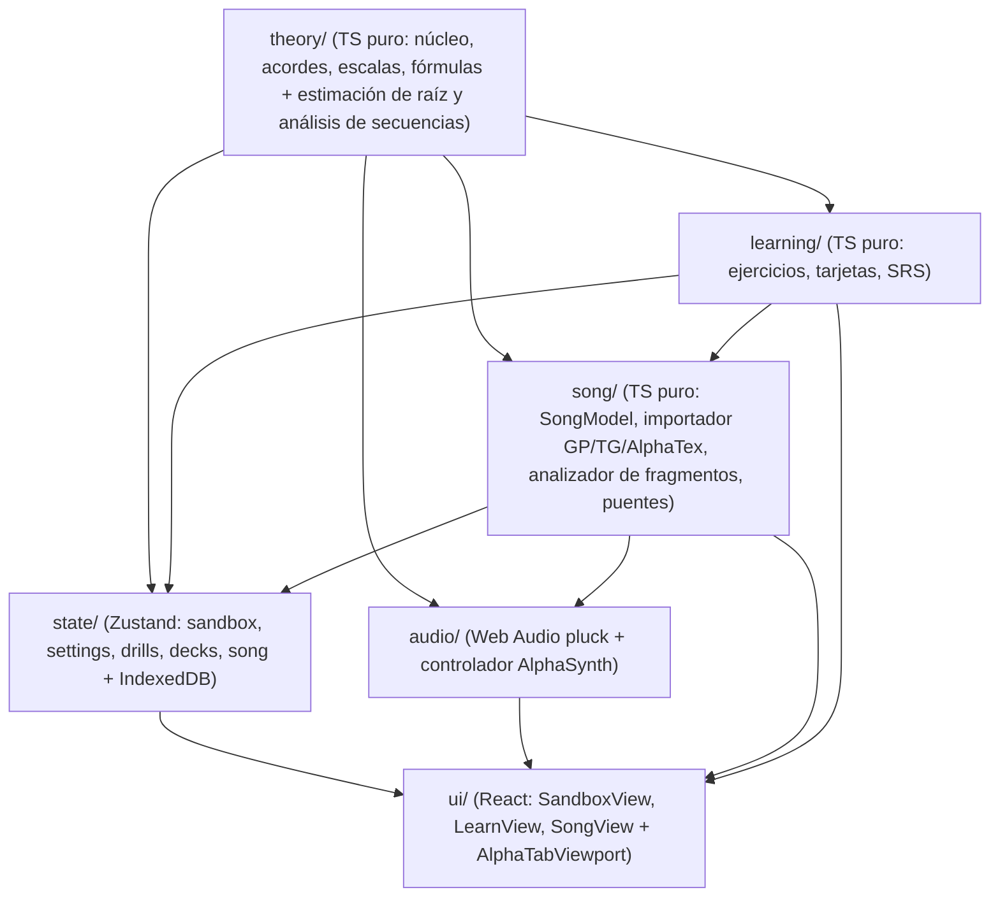

# Guitar Aid — Plan de la Fase 3 (Modo Canción: importación de tabs, reproducción multipista y análisis armónico) · v1

Documento canónico de **planificación, arquitectura, alcance y división de tareas** de la **Fase 3 (Modo Canción)**. Fija qué se construye, con qué arquitectura por capas, en qué hitos verificables y bajo qué criterios de aceptación. El diseño visual detallado está especificado en [interfaz_fase3.md](interfaz_fase3.md) (basado en la maqueta [Modo Canción · 1920×1080@1x.png](Modo%20Canci%C3%B3n%20%C2%B7%201920%C3%971080%401x.png)), que prevalece sobre este documento en lo relativo a la interfaz.

Base documental: [Requisitos.md](../Requisitos.md) (§9.2, hoja de ruta), [plan_fase1.md](../Fase-1/plan_fase1.md), [plan_fase1_1.md](../Fase-1/plan_fase1_1.md), [plan_fase2.md](../Fase-2/plan_fase2.md), [interfaz.md](../interfaz.md) y [decisiones.md](../decisiones.md).

---

## 1. Visión y objetivos

Las Fases 1 y 1.1 proporcionan un **Sandbox** para explorar la teoría libremente y la Fase 2 añade el modo **Aprender** para entrenar y memorizar notas, intervalos, fórmulas, digitaciones, escalas y progresiones.

La **Fase 3 (Modo Canción)** cierra el círculo permitiendo traer **canciones y tablaturas reales** (Guitar Pro `.gp`, `.gp3`–`.gp5`, `.gpx`, TuxGuitar `.tg`, MusicXML y AlphaTex) para practicarlas y comprender por qué funcionan musicalmente, manteniendo la filosofía central de Guitar Aid: **ver siempre el mástil de la guitarra sincronizado con el piano lineal y pensar en notas, intervalos y grados, no solo en números de traste**.

| # | Objetivo | Cómo lo cubre la Fase 3 |
|---|---|---|
| **O1** | **Conectar las tablaturas con el mástil y el piano en tiempo real** | Mientras suena la canción (o al inspeccionar cualquier pulso/compás en pausa), el **Mástil (`Fretboard`)** y el **Piano (`Piano`)** muestran en vivo las notas que se están tocando superpuestas sobre la escala/tonalidad activa (`scale-bg`), con etiquetas conmutables de **Nota, Intervalo o Grado** (respecto a la tonalidad o respecto al acorde del compás) y adaptándose automáticamente a la afinación de la pista. |
| **O2** | **Practicar canciones y pasajes con reproducción multipista 100 % offline** | Integración de **`@coderline/alphatab`** y su motor **`AlphaSynth`** con un archivo **SoundFont compacto empaquetado en local** (`public/soundfont/`). Permite reproducir todas las pistas (guitarras, bajo, batería) con sus articulaciones (*bends*, *slides*, ligados), controlar **Mute / Solo / Volumen** por pista, ajustar la **velocidad (`0.25×`–`2.0×`)**, activar **metrónomo y cuenta atrás**, conmutar vistas (**Tablatura**, **Partitura + Tablatura**, **Partitura** y **Letra**) y definir **bucles (`loop`)** por sección o rango de compases. |
| **O3** | **Analizar armónica y melódicamente cualquier compás o fragmento** | Selección de un compás, un rango de compases o una sección completa (*Intro*, *Estrofa*, *Estribillo*, *Solo*) para obtener un análisis teórico transparente que devuelve **siempre candidatos ordenados con razones estructuradas** (nunca una única respuesta impuesta): **tonalidad/escala por compás y global del fragmento** (ponderando duración y acento métrico y tolerando notas de paso), **acordes por compás** (con estimación de raíz) y **progresión armónica en números romanos**. |
| **O4** | **Respetar el criterio del usuario (sobreescritura manual por compás/sección)** | El usuario puede elegir en cualquier compás o sección un candidato alternativo de **acorde** o de **tonalidad/escala** (o fijarlo manualmente). Al hacerlo, las etiquetas de grado del mástil y del piano y el análisis de la progresión se recalculan de inmediato respecto a su elección, y la anotación queda guardada en la canción. |
| **O5** | **Conectar las canciones con los modos Sandbox y Aprender** | Desde cualquier compás, acorde, escala o progresión analizada en una canción, el usuario puede pulsar **«Abrir en Sandbox»** (para explorarlo libremente en el Sandbox) o **«Llevar a Aprender»** (para generar tarjetas SRS en un mazo nuevo o existente, o lanzar un ejercicio focalizado en esa escala/acordes). |

**Principio heredado:** la Fase 3 debe ser 100 % funcional sin conexión a internet, no puede degradar el arranque de los modos Sandbox ni Aprender (carga diferida de activos pesados) y debe mantener el aislamiento estricto por capas verificado con ESLint y tests unitarios.

---

## 2. Arquitectura y regla de capas

### 2.1. Nueva capa pura `src/song/` y extensión de `src/theory/`

Para que toda la lógica de extracción de compases, ponderación rítmica/métrica, estimación de raíz, detección de acordes con notas de paso y análisis de fragmentos sea **100 % determinista y verificable en tests unitarios rápidos (Node.js)** sin depender del DOM ni del renderizador gráfico de `alphaTab`, se introduce la capa **`src/song/`** en TypeScript puro:



- **Regla de capas verificada por ESLint (`eslint.config.js` + `src/architecture/layers.test.ts`):**
  1. `src/theory/`: no importa nada fuera de `src/theory/`.
  2. `src/learning/`: solo puede importar de `src/theory/`.
  3. **`src/song/` (NUEVA CAPA — TS puro):** puede importar de `src/theory/` y `src/learning/` (y el parser binario puro de `@coderline/alphatab` únicamente en `src/song/importer.ts`). **Tiene prohibido** importar React, DOM (`window`, `document`), Zustand, `src/state/`, `src/ui/` o `src/audio/`.
  4. `src/state/`: puede importar de `src/theory/`, `src/learning/` y `src/song/`.
  5. `src/ui/`: conecta stores, servicios de audio y componentes visuales. El widget de renderizado de `@coderline/alphatab` queda encapsulado en un único componente frontera (`src/ui/song/AlphaTabViewport.tsx`).

### 2.2. Estructura de carpetas propuesta

```text
public/
└── soundfont/
    └── sonivox.sf2                  # SoundFont compacto local para reproducción multipista 100 % offline
src/
├── theory/
│   └── analysis/
│       ├── estimateRoot.ts          # NUEVO: estimación de raíz ponderada (bajo, acento métrico, duración, 5ª)
│       ├── rankFragmentScales.ts    # NUEVO: ranking de escalas/tonalidades con tolerancia a notas de paso
│       └── analyzeProgression.ts    # NUEVO: análisis de secuencias de acordes (grados romanos y plantillas)
├── song/                            # NUEVA CAPA — TypeScript puro (sin React ni DOM)
│   ├── types.ts                     # SongModel, SongTrack, SongBar, SongBeat, SongNote, UserSongAnnotations
│   ├── importer.ts                  # Conversor puro (.gp, .gp3–.gp5, .gpx, .tg, .xml, AlphaTex) → SongModel
│   ├── presets.ts                   # 3 canciones/fragmentos de ejemplo en AlphaTex integrados en datos
│   ├── analyzer.ts                  # Ponderación rítmica/métrica, acordes por compás, tonalidad por compás y fragmento
│   ├── bridges.ts                   # Conversión pura de fragmentos/progresiones → Sandbox (MenuContext) y Aprender (DeckSource[])
│   └── index.ts                     # API pública de la capa song
├── audio/
│   ├── engine.ts                    # Motor Web Audio actual (pluck.ts) para clics manuales y previsualizaciones
│   └── alphaSynthController.ts      # NUEVO: fachada y control de reproducción multipista, bucle, velocidad y metrónomo
├── state/
│   └── song/                        # NUEVO: estado del Modo Canción y persistencia de biblioteca
│       ├── types.ts
│       ├── storage.ts               # Repositorio IndexedDB ('guitar-aid-songs-db') + fallback en memoria para tests
│       ├── store.ts                 # Zustand store: canción activa, pista, transporte, bucle, selección, overrides
│       ├── selectors/
│       │   ├── marks.ts             # selectSongFretboardMarks y selectSongPianoMarks (pulso + scale-bg + etiquetas)
│       │   └── analysis.ts          # Selectores memorizados de análisis del compás/rango activo
│       └── index.ts
└── ui/
    └── song/                        # NUEVO: interfaz del Modo Canción
        ├── SongView.tsx             # Contenedor principal (100vh)
        ├── SongTopBar.tsx           # Barra superior: biblioteca, pista/mezclador, transporte, bucle, tempo, vista
        ├── SongContextStrip.tsx     # Franja sobre el mástil: compás/pulso, tonalidad y acorde activos, etiquetas
        ├── SongTimelineBar.tsx      # Cinta de secciones y compases con tonalidad y acorde por compás
        ├── AlphaTabViewport.tsx     # Visor de partitura/tablatura/letra y selección de rangos
        ├── SongAnalysisPanel.tsx    # Panel derecho: escalas/tonalidad, acordes/progresión, overrides y puentes
        ├── TrackMixerPopover.tsx    # Control de Mute / Solo / Volumen por pista
        └── SongLibraryModal.tsx     # Biblioteca reciente (IndexedDB), canciones de ejemplo y Drag & Drop
```

---

## 3. Modelo de dominio y motores teóricos nuevos

### 3.1. Modelo intermedio puro de canción (`src/song/types.ts`)

Desacopla por completo la aplicación de las estructuras internas mutables de `alphaTab`:

```ts
export interface SongNote {
  string: number;              // 1 = cuerda más aguda .. N = más grave (según la afinación de la pista)
  fret: number;                // 0..24+
  midi: number;                // Altura MIDI real sonando
  pc: PitchClass;              // Clase de altura (0..11)
  durationTicks: number;       // Duración en ticks rítmicos (960 ticks = 1 negra)
  isTied: boolean;             // Nota ligada desde el pulso anterior
  isGhost: boolean;            // Nota fantasma / de adorno (menor peso armónico)
  bendSemitones?: number;      // Semitonos de bend si aplica (para reflejar la altura destino)
}

export interface SongBeat {
  index: number;               // Índice del pulso dentro del compás (0..)
  startTick: number;           // Posición de inicio relativa al compás
  durationTicks: number;       // Duración del pulso
  metricWeight: number;        // Peso métrico precalculado (1.5 en tiempo 1, 1.2 en fuerte secundario, 1.0 a tierra, 0.75 en contratiempo)
  chordAnnotation?: string;    // Cifrado de acorde anotado en la partitura si el archivo lo trae (p. ej. "Am7")
  lyrics?: string;             // Sílaba o texto de letra asociado al tiempo
  notes: readonly SongNote[];
}

export interface SongBar {
  index: number;               // Índice 0-based (compás 1 = index 0)
  number: number;              // Número de compás visible (1..N)
  timeSignature: { numerator: number; denominator: number };
  tempoBpm: number;            // Tempo vigente en este compás
  keySignature?: { accidentalCount: number; mode: 'major' | 'minor' }; // Armadura declarada en el archivo
  sectionMarker?: string;      // Nombre de sección si comienza o rige aquí (p. ej. "Intro", "Estribillo", "Solo")
  beats: readonly SongBeat[];
}

export interface SongTrack {
  index: number;
  name: string;                // p. ej. "Guitarra Rítmica", "Lead Guitar", "Bajo"
  isPercussion: boolean;       // true en pistas de batería (excluidas del análisis armónico)
  stringCount: number;         // Número de cuerdas del instrumento (habitualmente 6 en guitarra, 4/5 en bajo)
  tuning: Tuning;              // Afinación resuelta (compatible con nuestro catálogo o personalizada de la pista)
  capoFret: number;            // Traste de cejilla (capo) si la pista lo define (0 si no hay)
  bars: readonly SongBar[];
}

export interface SongModel {
  id: string;
  title: string;
  artist: string;
  album?: string;
  initialTempoBpm: number;
  tracks: readonly SongTrack[];
}
```

### 3.2. Ponderación rítmica y métrica de notas (`src/song/analyzer.ts`)

En una canción real conviven notas estructurales (bajos, acordes rítmicos, notas largas en tiempos fuertes) con notas melódicas de paso. Para que los algoritmos de teoría distingan unas de otras de forma natural, cada nota $n$ en un pulso $b$ aporta a su clase de altura `pc` un peso:

$$\text{weight}(n) = \frac{n.\text{durationTicks}}{960} \times b.\text{metricWeight} \times w_{\text{bajo}}(n) \times w_{\text{articulación}}(n)$$

- **$b.\text{metricWeight}$ (acento métrico):** `1.5` en el primer pulso del compás (*downbeat*), `1.2` en el pulso fuerte intermedio (p. ej. tiempo 3 en `4/4` o tiempo 4 en `6/8`), `1.0` en el resto de tiempos a tierra y `0.75` en subdivisiones débiles (*off-beats*).
- **$w_{\text{bajo}}(n)$ (registro grave):** `1.35` si $n$ es la nota MIDI más grave que suena en ese pulso (y `1.5` si además está en el primer tiempo del compás), `1.0` en el resto.
- **$w_{\text{articulación}}(n)$:** `0.35` si es nota fantasma (*ghost note*) o *grace note* muy breve (`durationTicks < 120`), `1.0` en caso contrario.

### 3.3. Estimación de raíz (`estimateRoot` en `src/theory/analysis/estimateRoot.ts`)

Tal como se previó en [plan_fase1.md](../Fase-1/plan_fase1.md) (§2: *"No hay estimación de raíz en el Sandbox; queda para el modo Canción"*):

- Recibe las observaciones de un compás o segmento (`{ pc, midi, weight, isDownbeat, isBass }[]`).
- Evalúa cada una de las 12 clases de altura $r \in [0..11]$ sumando:
  1. **Peso en el bajo (`bassScore`):** peso acumulado cuando $r$ suena como la nota más grave.
  2. **Ataque en tiempo 1 (`downbeatScore`):** bonificación si $r$ abre el compás o el cambio armónico.
  3. **Soporte acústico de 5ª justa (`fifthSupportBonus`):** bonificación cuando la clase `(r + 7) mod 12` está presente con peso significativo en el mismo segmento (refuerza la serie armónica fundamental–quinta).
  4. **Peso rítmico global (`totalWeight`).**
- Devuelve `Candidate<PitchClass>[]` ordenado con códigos de razón estructurados (`bassNoteInBar`, `downbeatAccent`, `fifthSupport`, `longestDuration`).

### 3.4. Detección de acordes por compás (`detectBarChords` en `src/song/analyzer.ts`)

A diferencia del Sandbox (donde el usuario pulsa únicamente las notas de un acorde y `detectChords` descarta cualquier candidato si hay una sola nota fuera de `allowedMask`), en un compás de canción suele haber notas melódicas de paso o arpegios mezclados con riffs:

1. **Filtrado de notas de paso y evaluación de las `19 calidades × 12 raíces`:**
   - Para cada candidato de acorde $(R, Q)$ del catálogo (`CHORD_QUALITIES`):
     - Calcula el **peso cubierto (`coveredWeight`)**: suma de pesos de las notas del compás que pertenecen a los tonos del acorde (`requiredMask | optionalMask` rotado a $R$).
     - Calcula el **ratio de cobertura (`coverageRatio = coveredWeight / totalBarWeight`)**.
     - Verifica los tonos característicos (fundamental $R$, 3ª o suspensión, 5ª/7ª, o díada de quinta `[0, 7]` para *power chords* `5`).
2. **Puntuación y razones estructuradas:**
   - Prioriza:
     1. Cobertura de peso $\ge 70\%$ (o el candidato de mayor cobertura si el compás es puramente melódico).
     2. Coincidencia con la raíz estimada por `estimateRoot` (`rootMatches` / `invertedBass`).
     3. Coincidencia con el cifrado anotado en la pista de Guitar Pro si existe (`annotatedInScore`).
     4. Peso intrínseco de la calidad en `CHORD_QUALITY_WEIGHTS` y menor número de notas omitidas.
   - Si en un compás largo (`4/4`) se detectan dos bloques armónicos claramente diferenciados entre la primera mitad (tiempos 1–2) y la segunda mitad (tiempos 3–4), expone el acorde principal del compás y el desglose opcional por mitad de compás.
   - Si un compás está en silencio o contiene solo una nota aislada sin contexto armónico suficiente, lo indica explícitamente (`unrecognized` / nota única) sin inventar un acorde falso.

### 3.5. Estimación de tonalidad/escala por compás y por fragmento (`rankScalesForFragment` y `detectSongKeysByBar`)

1. **Ranking de escalas para un fragmento (`rankScalesForFragment`):**
   - Recibe `WeightedPc[]` acumulados del rango de compases seleccionado `[startBar, endBar]`, la raíz/tónica estimada del primer y último compás del rango y los acordes principales detectados.
   - Evalúa las `12 tónicas × 22 escalas` del catálogo (`SCALE_TYPES`).
   - **Tolerancia a cromatismos y notas de paso:** no exige que el 100 % de las notas estén dentro de la escala (permite hasta un porcentaje configurable de peso fuera de la escala, identificando explícitamente qué notas quedan fuera como `passingTones: PitchClass[]`).
   - Ordena los candidatos por:
     1. **Cobertura ponderada (`scaleCoverage`):** porcentaje del peso musical total explicado por la escala (p. ej. `97 %`).
     2. **Encaje armónico (`fitsDetectedChords`):** cuántos de los acordes del fragmento son diatónicos a la escala.
     3. **Centro tonal (`tonicMatches`):** coincidencia de la tónica con el acorde de apertura/resolución del fragmento o con la armadura del compás (`matchesKeySignature`).
     4. **Popularidad en el catálogo (`scaleCommonness`):** `SCALE_WEIGHTS` (mayor, menor natural, pentatónicas y modos comunes por encima de escalas exóticas a igualdad de cobertura).
2. **Tonalidad por compás con suavizado contextual (`detectSongKeysByBar`):**
   - Para mostrar la **tonalidad local de cada compás** sin que cambie erráticamente en cada compás que tenga solo 2 o 3 notas:
     - Combina el peso del compás $i$ con una ventana contextual atenuada de los compases vecinos ($[i-1, i+1]$ dentro de la misma sección) y aplica un **bono de continuidad armónica** a mantener la tonalidad del compás anterior salvo que una nueva tonalidad supere claramente en cobertura durante $\ge 2$ compases o al inicio de una nueva sección (*Modulación detectada*).

### 3.6. Análisis de progresión del fragmento (`analyzeChordSequence`)

Dada la secuencia de acordes de un rango de compases (respetando cualquier acorde o tonalidad que el usuario haya fijado manualmente):
- Asigna a cada acorde su **función en números romanos** respecto a la tonalidad activa:
  - **Grados diatónicos:** `I`, `ii`, `iii`, `IV`, `V`, `vi`, `vii°` (o en menor natural/armónica/melódica: `i`, `ii°`, `♭III`, `iv`, `v`, `V`, `V7`, `♭VI`, `♭VII`, `vii°7`).
  - **Dominantes secundarios y préstamos modales comunes:** identifica e indica relaciones frecuentes en canciones reales como `V/vi` (p. ej. `E7` hacia `Am` en Do mayor), `V/V` (`D7` hacia `G` en Do mayor), `iv` menor prestado en tonalidad mayor (`Fm` en Do mayor) o `♭VII` / `♭VI` (*backdoor / rock cadence*).
- Detecta coincidencias exactas o subsecuencias con las **10 plantillas canónicas de `progressions.ts`** (`I–V–vi–IV`, `I–IV–V`, `ii–V–I`, `i–♭VII–♭VI–V`, etc.) devolviendo candidatos ordenados con razones estructuradas.

---

## 4. DECISIONES DE DISEÑO CONFIRMADAS POR EL USUARIO

Las siguientes decisiones fundacionales han sido consultadas y cerradas para definir el alcance de la Fase 3:

| # | Ámbito | Decisión confirmada |
|---|---|---|
| **1** | **Motor de audio en Canción** | **`AlphaSynth` con SoundFont compacto local (`public/soundfont/`, 100 % offline):** reproduce todas las pistas de la tablatura con sus timbres e interpretaciones reales (*bends*, *slides*, batería, bajo), soporta *Mute / Solo / Volumen* por pista, control de velocidad (`0.25×`–`2.0×`), metrónomo y bucle de secciones. Nuestro motor **`src/audio/pluck.ts`** se mantiene para los clics manuales sobre el mástil/piano y para previsualizar acordes, escalas y progresiones en el panel de análisis. |
| **2** | **Biblioteca de canciones y persistencia** | **Persistencia en `IndexedDB` («Biblioteca reciente») + 3 canciones de ejemplo integradas:** las canciones importadas por el usuario (`.gp`, `.gp3`–`.gp5`, `.gpx`, `.tg`, `.xml`) y sus anotaciones manuales se guardan en `IndexedDB` para que sobrevivan al recargar o cerrar el navegador sin chocar con el límite de 5 MB de `localStorage`. Además, se incluyen **3 canciones/fragmentos de ejemplo en AlphaTex** listos para usar desde el primer instante. |
| **3** | **Disposición visual y sincronización de instrumentos** | **Mástil y Piano siempre visibles y sincronizados en tiempo real en la parte superior:** muestran las notas activas del pulso/compás actual más la escala/tonalidad activa de fondo (`scale-bg`) con etiquetas conmutables (`Nota · Intervalo · Grado · Ninguna`). Debajo se sitúan el **visor de partitura/tablatura** (conmutable entre `Tab`, `Partitura + Tab` y `Partitura`, con soporte de **letra** y acordes) y el **panel de análisis del fragmento**. |
| **4** | **Alcance del análisis armónico, overrides manuales y puentes** | Se incluyen las **4 capacidades clave**: **(a)** estimación ponderada por duración y peso métrico de tonalidad/escalas y acordes por compás y por rango devolviendo candidatos ordenados con razones; **(b)** posibilidad de **fijar o sobreescribir manualmente** el acorde o la tonalidad de un compás/sección para que los grados del mástil y piano se calculen respecto a esa elección; **(c)** botón **«Abrir en Sandbox»** desde cualquier acorde, escala o compás; y **(d)** integración **«Llevar a Aprender»** para crear/ampliar un mazo de tarjetas SRS o practicar el fragmento en `Ejercicios`. |

---

## 5. Diseño de la interfaz del Modo Canción (`src/ui/song/`)

Siguiendo los principios de [interfaz.md](../interfaz.md) y [interfaz_fase2.md](../Fase-2/interfaz_fase2.md): **una sola pantalla (`100vh`, `overflow: hidden`)** optimizada para **1920×1080** y **2560×1440** (con adaptación limpia a **1440×900** y caída a 1 columna con scroll por debajo de `1100 px`).

### 5.1. Estructura general y presupuesto de altura

| Zona | Alto (`1920×1080` / `2560×1440` / `≤ 950 px`) | Contenido principal |
|---|---|---|
| **Menú lateral (`SideNav`)** | `76 px` colapsado (`240 px` expandido), `100vh` | Logo, `Sandbox`, `Aprender`, **`Canción`** (activo, sin el badge `próx.`), atajos contextuales del modo Canción y colapsar/expandir |
| **1. Barra superior (`SongTopBar`)** | `48 px` / `54 px` / `46 px` | Botón `📂 Canciones` (Biblioteca + Importar) · Título · Selector de `Pista` + `🎛️ Mezclador` · Transporte (`⏮`, `▶/⏸`, `🔁 Bucle`, `Velocidad 0.25×–2×`, `Metrónomo`) · Vista (`Tab` \| `Partitura+Tab` \| `Partitura` + `Letra`) · `Sonido [M]` y `⚙ Ajustes` |
| **2. Zona de Instrumentos (`SongContextStrip` + `Fretboard` + `Piano`)** | `≈ 310 px` / `≈ 380 px` / `≈ 280 px` | `SongContextStrip` (`38 px`) + `Fretboard` y `Piano` sincronizados en tiempo real con el pulso activo y la tonalidad/acorde del compás |
| **3. Área inferior (2 columnas: Partitura + Análisis)** | Resto del alto (`≈ 690 px` en `1080p` / `≈ 970 px` en `1440p`) | **Columna izquierda (`~62 %`):** `SongTimelineBar` (cinta de secciones y compases) + `AlphaTabViewport` (partitura/tablatura/letra con scroll interno sincronizado). **Columna derecha (`~38 %`):** `SongAnalysisPanel` (análisis de escalas/tonalidad, acordes/progresión, overrides y puentes a Sandbox/Aprender) |

### 5.2. Franja de contexto de la canción (`SongContextStrip`)

Situada justo encima del `Fretboard` con maquetación estable para evitar saltos de controles durante la reproducción:

1. **Izquierda — Posición y selección activa:**
   - Muestra `Compás {N} · Pulso {B}` junto con la insignia de la sección actual (p. ej. `Estribillo`). Si hay un rango de compases seleccionado para bucle/análisis, muestra `Seleccionado: Compases {A}–{B}` y botón rápido `✕ Quitar selección`.
2. **Centro — Armonía activa del compás y referencia de grados:**
   - **Tonalidad activa:** píldora interactiva `Tonalidad: {Nombre} {📌 si es manual} ▾` (permite cambiar entre las tonalidades candidatas o volver a `Automática`).
   - **Acorde activo:** píldora interactiva `Acorde: {Nombre} ({GradoRomano}) {📌 si es manual} ▾` (permite elegir otro candidato para el compás actual).
   - **Referencia de intervalos/grados:** conmutador segmentado compacto **`Grados: Tonalidad | Acorde`** (determina si las etiquetas `1, ♭3, 5` del mástil y piano se calculan respecto a la tónica de la tonalidad del compás o respecto a la fundamental del acorde que suena en ese compás).
3. **Derecha — Etiquetas e instrumentos:**
   - Conmutador `Etiquetas: Nota · Intervalo · Grado · Ninguna` (conectado a `settingsStore`).

### 5.3. Cinta armónica de secciones y compases (`SongTimelineBar`)

Situada en la cabecera de la columna izquierda, justo encima del visor de tablatura:
- Muestra una tira horizontal desplazable con los compases de la canción agrupados bajo sus **marcadores de sección** (`Intro`, `Estrofa`, `Estribillo`, `Solo`…).
- Cada celda de compás muestra:
  - Número de compás (`1`, `2`, `3`…).
  - Acorde principal detectado o fijado (p. ej. `Am7`, `G`, `Fmaj7` con indicador `📌` si tiene override manual).
  - Banda superior de color suave indicando la **tonalidad local** (haciendo visible de un vistazo dónde hay un cambio de tonalidad o modulación).
- **Interacción rápida:**
  - **Clic en un marcador de sección:** selecciona todos los compases de esa sección para analizarlos y/o activarlos como bucle.
  - **Clic en un compás:** mueve el cursor a ese compás e inspecciona su armonía.
  - **Shift + Clic (o arrastrar):** selecciona el rango de compases `[startBar, endBar]`.

### 5.4. Panel de análisis del fragmento (`SongAnalysisPanel`)

En la columna derecha inferior, analiza el **rango de compases seleccionado** (`[startBar, endBar]`) o, si no hay rango seleccionado, el **compás actual**:

1. **Cabecera del panel:**
   - Indica qué se está analizando (`Analizando: Compases 5–8 (Estribillo)` o `Analizando: Compás 12`) y un conmutador `Fuente: Pista activa | Todas las pistas armónicas`.
2. **Sección 1 — `Tonalidad y Escalas sugeridas`:**
   - Lista los candidatos ordenados de `rankScalesForFragment` mostrando:
     - Nombre de la escala/tonalidad (p. ej. `A menor natural (Eólico)`), relación con la escala madre (`VI grado de C mayor`) e insignia de cobertura (`96 %`).
     - Razones traducidas a español (`cubre el 96 % de la duración`, `encaja con 4 de 4 acordes`, `1 nota de paso: G♯`).
   - **Acciones por candidato:** pasar el cursor (`hover`) previsualiza la escala en `Fretboard` y `Piano`; clic en **`📌 Fijar tonalidad`** la aplica como tonalidad activa del compás/rango; botón **`↗ Sandbox`** la abre en el modo Sandbox.
3. **Sección 2 — `Acordes por compás y Progresión`:**
   - **Resumen de la progresión:** secuencia de chips interactivos `Compás → Acorde (Grado romano)` (p. ej. `c.5 Am (i)` → `c.6 G (♭VII)` → `c.7 F (♭VI)` → `c.8 E7 (V7)`), indicando debajo si coincide con una plantilla conocida (`Cadencia andaluza: i–♭VII–♭VI–V en La menor`) y botón **`▶ Escuchar progresión`** (con nuestro motor `pluck.ts`).
   - **Inspector de candidatos del compás seleccionado:** al hacer clic en cualquiera de los compases de la secuencia, muestra la lista ordenada de candidatos de acorde de ese compás (`1. Am7 · 92 %`, `2. C6/A · 88 %`, `3. Am · 81 %`) con sus razones (`contiene las 4 notas`, `bajo en A en tiempo 1`, `anotado en partitura`), permitiendo:
     - Escuchar el acorde (`▶`), previsualizarlo en mástil y piano (`hover`), **fijarlo manualmente (`📌`)** para ese compás o **abrirlo en Sandbox (`↗`)**.
4. **Sección 3 — `Puente con Sandbox y Aprender`:**
   - **`↗ Abrir selección en Sandbox`:** envía la escala/acorde o las notas del pulso actual al store del Sandbox y conmuta al modo Sandbox.
   - **`🃏 Crear / añadir a mazo SRS`:** abre un diálogo rápido que genera reglas `DeckSource` con los acordes, digitaciones, escalas y la progresión detectada del fragmento, permitiendo crear un mazo nuevo (p. ej. *"Canción: [Título] — Estribillo"*) o incorporarlos a un mazo existente en `decksStore`.
   - **`🎯 Practicar en Ejercicios`:** lleva a la sección `Ejercicios` del modo Aprender preconfigurando el rango de trastes donde se desarrolla el fragmento y las cuerdas utilizadas.

---

## 6. Fuera de alcance de la Fase 3

Para mantener el proyecto acotado y entregable con la máxima calidad, quedan explícitamente fuera de la Fase 3:
- **Edición o escritura de partituras/tablaturas:** Guitar Aid es una herramienta de comprensión teórica, análisis y práctica, no un editor de partituras (no se crean ni modifican notas de archivos `.gp`).
- **Entrada de micrófono / detección de audio en vivo o afinador:** reservado íntegra y exclusivamente para la **Fase 4 (Audio)**.
- **Sincronización con audio MP3/WAV externo o *stem separation*:** la reproducción se realiza a partir de la partitura multipista mediante `AlphaSynth`.
- **Reconocimiento óptico de partituras (OMR / PDF / imágenes) o tablaturas ASCII de texto libre sin estructura rítmica:** solo se importan formatos estructurados (`.gp`, `.gp3`–`.gp5`, `.gpx`, `.tg`, `.xml`/`.musicxml` y `AlphaTex`).

---

## 7. División de tareas por hitos (Hoja de ruta de implementación)

Se mantiene la regla de oro de las fases anteriores: **teoría y modelo puro → estado y persistencia → motor de audio/visor → interfaz e integración**. Cada hito incluye su batería de tests automatizados y **ningún hito se cierra si `pnpm test`, `pnpm lint` o `pnpm build` fallan**.

| Hito | Nombre | Capa | Tareas detalladas | Verificación y Criterios |
|---|---|---|---|---|
| **C0** | **Preparación, `@coderline/alphatab`, SoundFont local y capa `src/song/`** | Config / Arquitectura | 1. Instalar `@coderline/alphatab` y copiar el SoundFont compacto (`sonivox.sf2`) a `public/soundfont/` para carga 100 % offline.<br>2. Crear `src/song/types.ts` e `index.ts` con el modelo puro `SongModel`.<br>3. Actualizar `eslint.config.js` y `src/architecture/layers.test.ts` añadiendo las restricciones de importación de `src/song/`. | `layers.test.ts` pasa al 100 %; `pnpm build` y `pnpm lint` limpios. Cubre **(a)**. |
| **C1** | **Teoría para Canción: estimación de raíz, escalas de fragmento y secuencias** | `src/theory/analysis/` | 1. Implementar `estimateRoot` (ponderación por bajo, tiempo 1, duración y soporte de 5ª justa).<br>2. Implementar `rankScalesForFragment` (cobertura ponderada, tolerancia a notas de paso `passingTones`, encaje con acordes y armadura).<br>3. Implementar `analyzeChordSequence` (grados romanos diatónicos, dominantes secundarios `V/x`, préstamos modales y detección de plantillas de `progressions.ts`) y añadir los nuevos `ReasonCode` en `types.ts` y `texts.ts`. | Tests unitarios puros en `src/theory/analysis/`. Cubre **(b), (c), (d)**. |
| **C2** | **Importador puro (`.gp`, `.tg`, `.xml`, AlphaTex) y canciones de ejemplo** | `src/song/` | 1. Implementar `src/song/importer.ts` usando `ScoreLoader` y `AlphaTexImporter` de `@coderline/alphatab` para transformar bytes o texto en nuestro `SongModel` puro (resolviendo afinaciones, capo, compases, secciones, letras y pesos métricos por tiempo).<br>2. Crear `src/song/presets.ts` con las **3 canciones de ejemplo integradas** en AlphaTex (*Pop Diatónico en C/Am*, *Blues & Rock Riff en E*, *Modulación y Menor Armónica en Am/C*). | Tests unitarios de `importer.ts` y `presets.ts` verificando pistas, afinaciones, compases y notas en Node.js. Cubre **(e)**. |
| **C3** | **Analizador puro de fragmentos, tonalidad por compás y puentes** | `src/song/` | 1. Implementar `src/song/analyzer.ts`: cálculo de `WeightedPc[]` por compás y rango, `detectBarChords` (candidatos de acorde por compás con razones y soporte de anotaciones de partitura), `detectSongKeysByBar` (tonalidad por compás con suavizado de continuidad y detección de modulaciones) y `analyzeSongFragment` (integrando overrides manuales del usuario).<br>2. Implementar `src/song/bridges.ts` para transformar un fragmento analizado en `MenuContext` (Sandbox) y en reglas `DeckSource[]` / configuración de ejercicio (Aprender). | Tests unitarios sobre las 3 canciones de ejemplo y casos límite (notas de paso, silencios, overrides, puentes). Cubre **(f), (g), (h)**. |
| **C4** | **Estado del Modo Canción (`state/song`), marcas e IndexedDB** | `src/state/song/` | 1. Implementar `src/state/song/storage.ts`: repositorio en `IndexedDB` (`guitar-aid-songs-db`, `version: 1`) con adaptador en memoria inyectable para tests, guardando canciones importadas y `userAnnotations` (overrides de acorde/tonalidad por compás y bucles).<br>2. Implementar `src/state/song/store.ts` (Zustand): gestión de canción activa, pista activa, posición de reproducción (`currentBar`, `currentBeat`), `loopRange`, `selectedBarRange`, `barOverrides`, `degreeReferenceMode` (`'key' \| 'chord'`), `scoreViewMode` (`'tab' \| 'score-tab' \| 'score'`), `showLyrics` y estado del mezclador por pista (`mute`, `solo`, `volume`).<br>3. Implementar `selectSongFretboardMarks` y `selectSongPianoMarks` (notas activas del pulso + `scale-bg` + etiquetas según `degreeReferenceMode`). | `src/state/song/song.test.ts` verificando estado, marcas, overrides y persistencia en IndexedDB simulado. Cubre **(h), (i), (j)**. |
| **C5** | **Controlador `AlphaSynth` offline y visor `AlphaTabViewport`** | `src/audio/` y `src/ui/song/` | 1. Implementar `src/audio/alphaSynthController.ts`: inicialización diferida de `AlphaSynth` con el SoundFont local, sincronización con `settingsStore` (`soundEnabled`, `volume`), control de Play/Pausa/Stop, velocidad (`0.25×`–`2.0×`), bucle `A–B`, metrónomo, cuenta atrás y Mute/Solo/Volumen por pista.<br>2. Implementar `src/ui/song/AlphaTabViewport.tsx`: renderizado reactivo de la pista activa en los 3 modos de vista (`Tab`, `Partitura + Tab`, `Partitura`) con letra, cursor sincronizado y selección de compases con ratón. | Tests unitarios y de componente con doble inyectable de `AlphaTabApi` / `AlphaSynth`. Cubre **(k)**. |
| **C6** | **UI (Parte 1): `SongView`, `SongTopBar`, `SongContextStrip` e instrumentos en vivo** | `src/ui/song/` | 1. Conectar `SongView` en `AppShell.tsx` (retirando el placeholder de *Próximamente* y el badge `próx.` de `SideNav`).<br>2. Implementar `SongTopBar` y `TrackMixerPopover` (transporte, bucle, velocidad, metrónomo, selector de pista, mezclador multipista y conmutador de vista).<br>3. Implementar `SongContextStrip` y conectar `Fretboard` y `Piano` para que reflejen en tiempo real las notas del pulso activo, la afinación de la pista y las etiquetas respecto a tonalidad o acorde. | Tests de integración de `SongView` y `AppShell` (cambio de modo conserva el estado de Sandbox, Aprender y Canción). Cubre **(i), (k), (l)**. |
| **C6b** | **Reimplementación del visor musical en sistemas continuos (Tablatura, Partitura y Tab+Partitura)** | `src/ui/song/` | 1. **Arquitectura de sistemas continuos:** sustituir el grid de cajas/tarjetas por compás por filas horizontales de sistemas con pautas continuas, cabecera de sistema a la izquierda y barras de compás musicales estándar.<br>2. **Implementación de la Vista Tablatura Continua:** líneas continuas de cuerda (6 para guitarra, 4 para bajo), rótulo vertical «T A B» único al inicio de cada sistema, numeración discreta de compás, marcadores de sección y números de traste nítidos.<br>3. **Posicionamiento métrico y acordes en su pulso real:** distribuir notas proporcionalmente al tiempo musical y posicionar los acordes en la coordenada horizontal exacta del pulso donde ocurren (admitiendo múltiples acordes por compás).<br>4. **Cursor interactivo a nivel de nota y pulso:** barra vertical turquesa que viaja nota a nota; clic directo sobre cualquier nota o pulso específico para situar el cursor y reposicionar el audio mediante `seekToTick`.<br>5. **Especificación formal de Partitura y Tab+Partitura:** fijar las reglas de grabado musical (clave, armadura y compás solo al inicio de sistema y en cambios reales de tonalidad/métrica; acoplamiento dual pentagrama + tablatura con cursor unificado). | Tests de sistemas continuos, clic en notas/pulsos específicos, soporte de múltiples acordes por compás y selección multirango. Cubre **(k), (o)**. |
| **C7** | **UI (Parte 2): Biblioteca de canciones (`SongLibraryModal`) y Drag & Drop** | `src/ui/song/` | 1. Implementar `SongLibraryModal`: pestaña de **Canciones recientes** (persistidas en IndexedDB con título, artista, fecha, tamaño y botón de eliminar), pestaña de **Canciones de ejemplo** (las 3 piezas integradas) y zona de importación de archivos `.gp`, `.gp3`–`.gp5`, `.gpx`, `.tg`, `.xml` y AlphaTex.<br>2. Añadir soporte de arrastrar y soltar (*Drag & Drop*) sobre `SongView` y validación defensiva con mensajes de error accesibles si un archivo está corrupto o vacío. | Tests de integración de biblioteca, carga de ejemplos e importación de archivos. Cubre **(e), (j)**. |
| **C8** | **UI (Parte 3): `SongTimelineBar` y `SongAnalysisPanel` con overrides** | `src/ui/song/` | 1. Implementar `SongTimelineBar`: cinta horizontal de secciones y compases mostrando la tonalidad local y el acorde de cada compás, con selección por clic (compás o sección entera) y `Shift + clic` (rango de compases).<br>2. Implementar `SongAnalysisPanel`: listas de candidatos ordenados de tonalidad/escala y de acordes por compás con sus razones, visualización de la progresión en números romanos, previsualización en mástil/piano al pasar el ratón, reproducción con `pluck.ts` (`▶`) y fijación de overrides manuales (`📌`). | Tests de integración de selección de fragmentos, ranking de candidatos y sobreescritura manual de acorde/tonalidad. Cubre **(f), (g), (h)**. |
| **C9** | **Integración con Sandbox y Aprender, atajos de teclado y cierre de Fase 3** | `src/ui/` y `docs/` | 1. Conectar en `SongAnalysisPanel` y `SongContextStrip` las acciones **«Abrir en Sandbox»**, **«Crear / añadir a mazo SRS»** (modal de exportación a `decksStore`) y **«Practicar en Ejercicios»** (`drillsStore`).<br>2. Añadir atajos de teclado del Modo Canción (<kbd>Espacio</kbd> Play/Pausa, <kbd>L</kbd> alternar bucle, <kbd>←</kbd>/<kbd>→</kbd> compás anterior/siguiente, <kbd>M</kbd> silenciar, <kbd>Esc</kbd> cerrar modales/quitar selección).<br>3. Completar tests de aceptación de la Fase 3, actualizar `README.md` y documentar en `docs/decisiones.md`. | Batería completa de aceptación (`a`–`n`), `pnpm test`, `pnpm lint` y `pnpm build` al 100 %. Cubre **(m), (n)**. |

---

## 8. Criterios de aceptación de la Fase 3

La Fase 3 se considera terminada cuando existen y pasan pruebas automatizadas para todos los criterios siguientes:

- **(a) Regla de capas:** `src/song/` importa únicamente de `src/theory/` y `src/learning/` (y el parser puro de `@coderline/alphatab` en `importer.ts`), sin importar React, DOM, Zustand, `state`, `ui` ni `audio` (verificado en `src/architecture/layers.test.ts`).
- **(b) Estimación de raíz (`estimateRoot`):** en un compás donde suena `A2` en el primer tiempo como nota más grave junto con `E3`, `A3`, `C4` y una nota de paso breve `B3` en subdivisión débil, `estimateRoot` devuelve `A` (`pc = 9`) en primera posición con las razones `bassNoteInBar`, `downbeatAccent` y `fifthSupport`.
- **(c) Detección de acordes con notas de paso (`detectBarChords`):** en un compás con un arpegio de `Am7` (`A–C–E–G`) que incluye una corchea de paso `B` o `D` en tiempo débil, `detectBarChords` devuelve `Am7` entre los primeros candidatos ordenados explicando el porcentaje de duración cubierto, sin devolver `[]` por culpa de la nota de paso.
- **(d) Ranking de escalas en fragmentos (`rankScalesForFragment`):** sobre un fragmento en La menor que incluye 4 compases diatónicos (`Am – G – F – E7` o `Am – Dm – G – C`) con una nota cromática puntual (`G♯` o `D♯`), el analizador devuelve `A menor natural` / `A menor armónica` como primeros candidatos indicando el porcentaje de cobertura y las notas de paso, por delante de escalas exóticas.
- **(e) Importación y canciones de ejemplo:** el importador puro carga sin errores archivos `.gp`/`.gp3`–`.gp5`/`.tg` y las 3 canciones de ejemplo en AlphaTex, extrayendo correctamente sus pistas, afinaciones, compases, secciones, letras y notas con cuerda y traste.
- **(f) Tonalidad por compás y detección de modulación (`detectSongKeysByBar`):** en la canción de ejemplo con modulación (sección A en La menor / Do mayor y sección B modulada, o cambio a menor armónica), el analizador asigna la tonalidad correspondiente a cada compás manteniendo la estabilidad dentro de cada sección sin saltar por notas de paso aisladas.
- **(g) Análisis de progresión de un fragmento (`analyzeSongFragment`):** al seleccionar los 4 compases de una sección con `C – G – Am – F` en tonalidad de Do mayor, el análisis devuelve los grados `I – V – vi – IV` y reconoce la plantilla canónica del catálogo.
- **(h) Sobreescritura manual de acorde o tonalidad (`barOverrides`):** cuando el usuario fija manualmente otro candidato de tonalidad (p. ej. `D dórico` en lugar de `C mayor`) o de acorde en un compás, las etiquetas de grado (`1`, `♭3`, `5`…) en `selectSongFretboardMarks` y `selectSongPianoMarks` y los numerales romanos de la progresión se recalculan de inmediato respecto a la elección del usuario.
- **(i) Sincronización en tiempo real y afinación de pista:** al avanzar el pulso activo o hacer clic en un compás, `Fretboard` y `Piano` muestran las notas del pulso (`pinned`/`root`) superpuestas sobre la escala activa del compás (`scale-bg`), adoptando automáticamente la afinación declarada por la pista activa (p. ej. Drop D) sin alterar la afinación guardada del Sandbox.
- **(j) Persistencia en `IndexedDB` («Biblioteca reciente»):** al importar una canción y fijar anotaciones manuales (`barOverrides` o bucles), tras simular una recarga de la aplicación la canción sigue disponible en la biblioteca reciente junto con sus anotaciones intactas. Si se intenta importar un archivo corrupto o inválido, se muestra un aviso accesible sin corromper el estado.
- **(k) Reproducción multipista, bucle y vistas de partitura:** la vista permite alternar entre `Tab`, `Partitura + Tab` y `Partitura` (con letra), configurar un bucle de compases `A–B` (o por sección), cambiar la velocidad (`0.25×`–`2.0×`) y controlar `Mute / Solo / Volumen` por pista.
- **(l) Independencia entre modos en `AppShell`:** cambiar entre `Sandbox`, `Aprender` y `Canción` desde `SideNav` conserva intacto el estado de cada modo; pulsar atajos de `Canción` (<kbd>Espacio</kbd>, <kbd>L</kbd>) no altera el Sandbox, y <kbd>C</kbd> en `Canción` no limpia el Sandbox.
- **(m) Puente «Abrir en Sandbox»:** pulsar *«Abrir en Sandbox»* sobre un acorde o escala detectada en el Modo Canción establece ese `context` en `sandboxStore` y navega automáticamente a la vista `Sandbox`.
- **(n) Puente «Llevar a Aprender»:** desde un fragmento analizado en el Modo Canción, la acción *«Crear / añadir a mazo SRS»* genera un mazo válido en `decksStore` cuyas tarjetas (`cardIds`) se resuelven al 100 % sin errores.
- **(o) Visualización en sistemas continuos e interactividad nota a nota:** la tablatura y partituras se disponen en sistemas horizontales continuos (sin troceado en tarjetas/cajas por compás); los acordes se posicionan en la coordenada temporal horizontal de su pulso real admitiendo múltiples acordes por compás; y hacer clic en cualquier nota o pulso específico posiciona el cursor en dicho pulso y sincroniza el transporte (`seekToTick`).
