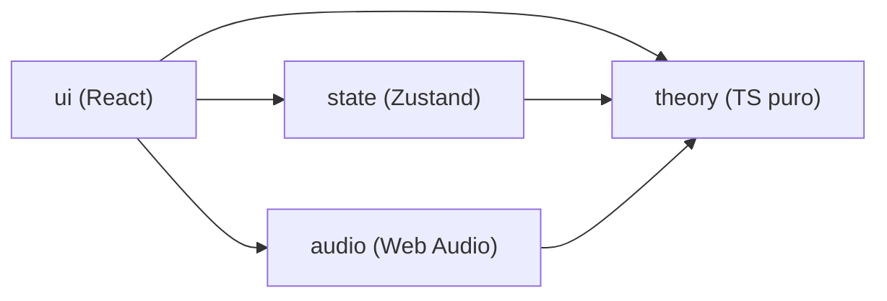

# Guitar Aid — Planificación inicial (Fase 1: Sandbox)

Basado en [Requisitos.md](file:///home/adri/Desktop/Guitar-Aid/docs/Requisitos.md). Todavía no hay código; el repositorio git ya está inicializado (rama `main`, commit inicial con los requisitos y un `.gitignore`).

---

## 1. Stack propuesto

Mantengo el stack que sugiere el documento y añado solo lo imprescindible.

| Área | Elección | Por qué |
|---|---|---|
| Lenguaje | **TypeScript** (modo `strict`) | El dominio (MIDI, intervalos, posiciones) se beneficia mucho del tipado. |
| Build / dev | **Vite** | Arranque instantáneo, HMR, build estático sin backend. |
| UI | **React 19** | Lo sugiere el documento; ecosistema maduro. |
| Teoría musical | **`tonal`** (envuelto en nuestro propio módulo) | Notas, intervalos, acordes, escalas, detección de acordes y modos ya resueltos y probados. Lo envolvemos para que la app nunca dependa de su API directamente. |
| Estado | **Zustand** (+ middleware `persist`) | Muy ligero, funciona fuera de React (útil para audio y atajos de teclado), y `persist` cubre la sección 6.7 guardando solo los ajustes, no la selección. |
| Gráficos | **SVG a mano** en componentes React | Mástil y teclado son geometría simple; no hace falta librería. |
| Sonido | **Web Audio API a mano** (sin Tone.js) | Un pluck con oscilador, filtro y envolvente basta; Tone.js añadiría unos 150 KB que no se necesitan. |
| Estilos | **CSS Modules** + variables CSS | Sin dependencias, con ámbito por componente y temas/contraste fáciles de ajustar. |
| Tests | **Vitest** (teoría y estado) + **Testing Library** (UI puntual) | Mismo pipeline que Vite y rápido. |
| Calidad | ESLint (flat config) + Prettier | Incluye una regla que **prohíbe importar React/DOM desde `src/theory`** para hacer cumplir la separación por capas. |
| Gestor de paquetes | **pnpm** | Es el que está instalado (Node 26, pnpm 12; `npm` no está disponible). |

> [!NOTE]
> Alternativa que he descartado por ahora: un monorepo pnpm con `packages/theory` aparte. Separaría todavía más las capas, pero para la Fase 1 es ceremonia de más. La regla de ESLint consigue el mismo aislamiento y la carpeta `src/theory` se puede extraer a un paquete sin cambios cuando lleguen las Fases 2 y 3.

---

## 2. Estructura de carpetas

```
Guitar-Aid/
├── docs/
│   ├── Requisitos.md
│   └── decisiones.md            # registro breve de decisiones teóricas/técnicas
├── public/
├── src/
│   ├── theory/                  # CAPA 1 — TS puro, sin React ni DOM
│   │   ├── data/                # catálogos en datos, ampliables
│   │   │   ├── chords.ts        # calidades: intervalos, símbolo, nombre
│   │   │   ├── scales.ts        # tipos: intervalos, familia/escala madre, alias
│   │   │   ├── tunings.ts       # afinaciones (grave → aguda)
│   │   │   └── progressions.ts  # plantillas (I–IV–V, ii–V–I, I–V–vi–IV…)
│   │   ├── note.ts              # MIDI ↔ nombre, clases de altura, enarmonía por contexto
│   │   ├── interval.ts          # intervalos, nombres (3ª menor…), grados
│   │   ├── chord.ts             # construir acordes y detectarlos (varios candidatos)
│   │   ├── scale.ts             # construir escalas, modos, relativas, diferencias
│   │   ├── fretboard.ts         # (cuerda, traste) ↔ MIDI, posiciones equivalentes, recolocación
│   │   ├── voicings.ts          # generador de digitaciones de guitarra para cualquier afinación
│   │   ├── suggestions/
│   │   │   ├── forNote.ts
│   │   │   ├── forChord.ts      # escalas que encajan + progresiones
│   │   │   ├── forScale.ts      # acordes diatónicos (romanos) + escalas relacionadas
│   │   │   └── ranking.ts       # puntuación y texto de "por qué encaja"
│   │   ├── types.ts
│   │   ├── index.ts             # API pública del módulo
│   │   └── *.test.ts            # tests junto a cada archivo
│   ├── state/                   # CAPA 2 — depende solo de theory
│   │   ├── selectionStore.ts    # notas activas + orígenes + posiciones fijadas
│   │   ├── settingsStore.ts     # ajustes persistidos (6.7)
│   │   ├── previewStore.ts      # previsualización de sugerencias
│   │   ├── selectors.ts         # datos derivados: nombres, intervalos, detección…
│   │   └── *.test.ts
│   ├── audio/                   # servicio Web Audio (sin React)
│   │   ├── engine.ts            # contexto, volumen, mute
│   │   └── pluck.ts             # síntesis + modos acorde/arpegio/escala
│   ├── ui/                      # CAPA 3 — React
│   │   ├── App.tsx
│   │   ├── layout/              # orientación, mostrar/ocultar instrumentos
│   │   ├── toolbar/             # afinación, ♯/♭, limpiar, sonido, volumen
│   │   ├── fretboard/           # Fretboard.tsx, geometría SVG, zurdo
│   │   ├── piano/               # Piano.tsx, rango y desplazamiento de octavas
│   │   ├── pickers/             # ChordPicker, ScalePicker, navegador de voicings
│   │   ├── panels/              # SelectionInfo, Suggestions
│   │   ├── hooks/               # atajos de teclado, etc.
│   │   └── styles/              # variables CSS, tema
│   └── main.tsx
├── index.html
├── eslint.config.js
├── vite.config.ts               # incluye la configuración de Vitest
├── tsconfig.json
├── package.json
└── .gitignore
```

**Dependencias permitidas** (las impone ESLint):



---

## 3. Decisiones de diseño clave

1. **Fuente de verdad (5.4):** la selección es un mapa `midi → { orígenes, posiciones fijadas en la guitarra }`. Cada instrumento es una vista derivada.
   - Si una nota se pulsa en la guitarra, queda **fijada** esa posición.
   - Si se pulsa en el piano o se elige en un menú, no se fija ninguna posición. Con "mostrar todas las posiciones" activado (valor por defecto), la guitarra la dibuja hueca en todas sus posiciones.
   - Las posiciones fijadas se dibujan como círculos llenos y sus equivalentes, huecas.
2. **Enarmonía:** internamente siempre se guarda el número MIDI. El nombre se calcula al mostrarlo según este orden de contexto: escala seleccionada → acorde seleccionado → acorde detectado → preferencia ♯/♭.
3. **Tónica de referencia** para intervalos y grados: la de la escala o acorde elegido en el menú. Si no hay ninguno, la raíz del primer acorde detectado. Si tampoco hay, la nota más grave.
4. **Detección de acordes:** usa `Chord.detect` de `tonal`, filtrado a nuestro catálogo y reordenado con un criterio explícito: primero la raíz en el bajo, luego la menor cantidad de tensiones, luego las calidades más comunes. Devuelve siempre todos los candidatos (C6 / Am7). Si no hay ninguno, la respuesta es explícitamente "no reconocido".
5. **Voicings:** se generan por algoritmo sobre el mástil, de modo que sirven para **cualquier afinación**. Restricciones: abarcar como máximo 4 trastes, contener todas las notas esenciales y tocar como máximo 4 dedos más cejilla. Después se ordenan por posición y por facilidad. Prefiero esto a una tabla fija de formas, que solo valdría para la afinación estándar.
6. **Encaje escala–acorde:** puntuación = notas del acorde contenidas + bonus de "naturalidad" (diatónica, escala común, sin chocar con la 3ª o la 7ª). Cada sugerencia lleva un texto con el motivo.
7. **Progresiones:** tonalidades mayores y menores donde el acorde es diatónico, con su grado romano, cruzadas con las plantillas de `progressions.ts`.
8. **Cambio de afinación:** cada posición fijada se recoloca primero en la misma cuerda y, si no cabe, en la posición más cercana. Si la nota queda fuera del rango del mástil, se avisa.
9. **Rendimiento (<100 ms):** el cálculo es trivial, con 6×25 posiciones y 128 notas. Usaré selectores memoizados y SVG sin re-renderizar todo el mástil.

---

## 4. Hitos

Cada hito sigue el orden teoría + tests → estado → UI, y termina con instrucciones para ejecutarlo y probarlo.

| # | Hito | Contenido principal | Criterios de aceptación |
|---|---|---|---|
| 0 | Esqueleto | Vite + React + TS, ESLint (con regla de capas), Prettier, Vitest, scripts `dev/test/build/lint` | — |
| 1 | Mástil y piano estáticos | `note.ts`, `fretboard.ts`, `tunings.ts`; SVG del mástil (24 trastes, marcas, zurdo) y del piano (C2–C7, desplazamiento en vertical) | base de 1 y 7 |
| 2 | Selección y sincronización | `selectionStore`, mostrar todas las posiciones, desplazamiento automático del piano, recolocar al cambiar afinación | 1, 2, 7 |
| 3 | Nombres, intervalos, grados | etiquetas conmutables, ♯/♭, panel de información, detección de acordes | 3, 4, 5 |
| 4 | Selectores de acorde y escala | catálogos, pickers, navegador de voicings | 3, 6 |
| 5 | Sugerencias | `suggestions/*`, previsualización con otro color, aplicar con un clic | 6 |
| 6 | Sonido | pluck, acorde/arpegio/escala, volumen, mute, atajos | — |
| 7 | Persistencia y pulido | `persist`, orientación y visibilidad, accesibilidad, contraste | 8, 9 |

---

## 5. Aclaraciones confirmadas

Todas están registradas en [decisiones.md](file:///home/adri/Desktop/Guitar-Aid/docs/decisiones.md) y aplicadas en [Requisitos.md](file:///home/adri/Desktop/Guitar-Aid/docs/Requisitos.md).

1. La cuerda 1 es la más aguda y la 6 la más grave. Criterio 1: cuerda 5, traste 7 → **E3**.
2. Una sola entrada para **Mayor / Jónico** y otra para **Menor natural / Eólico**.
3. Disposición por defecto horizontal: guitarra arriba, piano debajo.
4. "Mostrar todas las posiciones" está **activado** por defecto. La posición pulsada en la guitarra se dibuja como círculo lleno y las equivalentes como círculos huecos o translúcidos.
5. Rango del piano **C2–C7** (61 teclas).
6. Blues mayor: 1 – 2 – ♭3 – 3 – 5 – 6.
